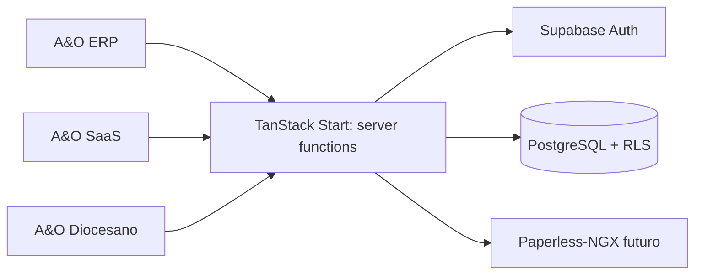

# Decisión de arquitectura backend

Estado: propuesta para aprobación. No implementada.

## Recomendación

Adoptar PostgreSQL administrado mediante Supabase como backend central, con
Supabase Auth, RLS, migraciones SQL versionadas y TanStack Start para las
operaciones server-side de A&O. Paperless-NGX permanecerá como servicio
documental externo, detrás del backend de A&O.

La decisión es condicional: primero debe aprobarse proveedor, región,
retención, tratamiento de datos y presupuesto. No se crean proyectos,
credenciales, tablas ni migraciones en esta fase.

## Comparación

| Alternativa | Ventajas | Riesgos | Resultado |
|---|---|---|---|
| PostgreSQL + Supabase | Auth, Postgres, RLS, backups y API integrados; buen ajuste SaaS | Dependencia de proveedor, límites y costos por uso | Recomendada inicialmente |
| PostgreSQL autoadministrado | Control y portabilidad máximos | Operación de Auth, backups, HA, parches y observabilidad | Alternativa por soberanía |
| MySQL/MariaDB | Ecosistema conocido | RLS no es equivalente; aislamiento queda más en aplicación | No recomendada |

PostgreSQL encaja mejor porque el aislamiento es una propiedad del dato y RLS
puede reforzarla en cada consulta. La autorización seguirá siendo doble:
política de base de datos y autorización de negocio en el servidor.

## Límites de producto

SaaS administra organizaciones, planes, licencias y configuración comercial.
ERP administra la operación de cada parroquia/institución. Diocesano administra
su jurisdicción y alcance agregado. No se compartirán tablas de negocio sin un
contrato explícito; una integración no concede acceso automático.

## Riesgos y aprobación

Supabase Auth SSR requiere sesiones en cookies y PKCE; la documentación actual
marca `@supabase/ssr` como beta. Antes de implementar deben fijarse versiones,
región, política de cache, DPA, clasificación de datos y estrategia de salida.

Referencias: [Supabase Auth SSR](https://supabase.com/docs/guides/auth/server-side),
[seguridad de datos](https://supabase.com/docs/guides/database/secure-data),
[TanStack Start](https://tanstack.com/start/latest).
