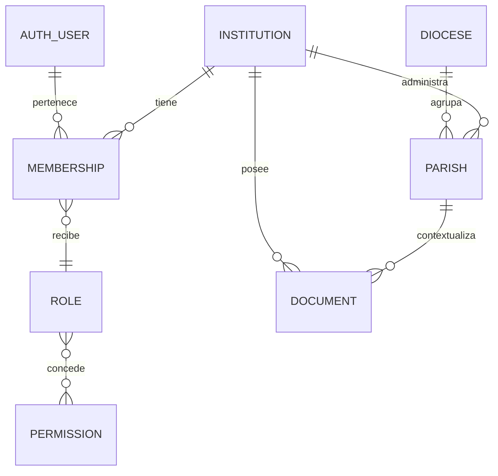

# Modelo multiinstitución

Estado: diseño conceptual.

## Entidades y contexto

Entidades mínimas: `auth.users` como identidad, `profiles`, `institutions`,
`dioceses`, `parishes`, `institution_memberships`, `roles`, `permissions`,
`role_permissions`, `active_institution_contexts` y `audit_events`.

Cada entidad de negocio debe incluir `institution_id`; las entidades parroquiales
deben incluir `parish_id` cuando aplique. Las claves son UUID generadas en el
servidor/base de datos. Los códigos documentales tienen unicidad dentro de su
ámbito institucional, no global.

La interfaz puede solicitar cambio de contexto, pero el servidor lo resuelve
contra la membresía vigente. El `institution_id` del navegador es una sugerencia
y nunca una autorización. El contexto efectivo se deriva de sesión, membresía,
rol, estado de institución y alcance parroquial.

Un usuario puede tener varias membresías. Una membresía suspendida no permite
consultas aunque el usuario conserve una sesión válida. El alcance diocesano no
implica acceso a datos personales, sacramentales o contables de cada parroquia.

## Integridad

Las relaciones entre documentos, expedientes, fondos, parroquias y transferencias
deben comprobar la misma institución en el servidor y con claves foráneas. La
eliminación ordinaria será lógica cuando existan relaciones, retención o auditoría.
No se mezclan asientos sacramentales con libros archivísticos: el archivo solo
referencia el registro de origen autorizado.

## Decisiones pendientes

Definir si una institución puede pertenecer a más de una diócesis, quién puede
crear instituciones, si el contexto activo vive en cookie/sesión o perfil, y qué
alcances diocesanos serán permitidos por módulo.
