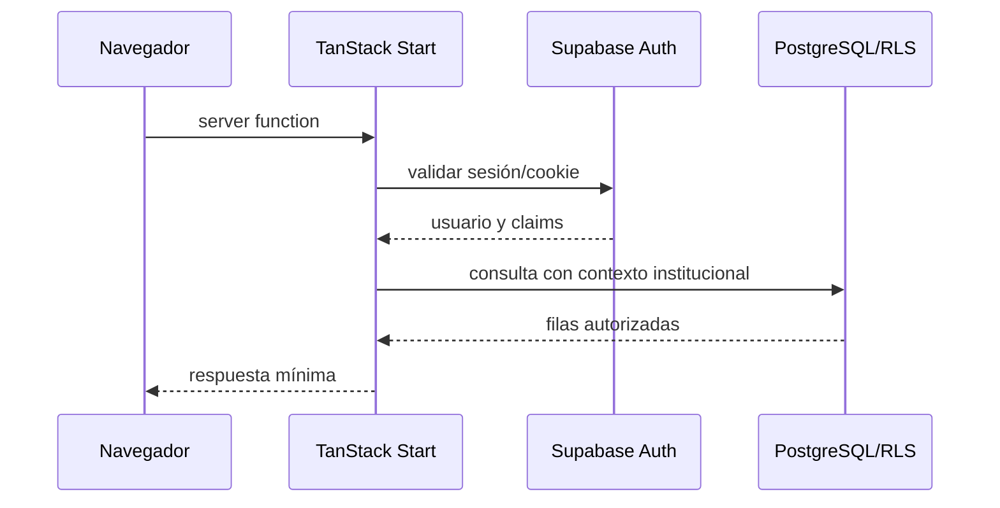

# Autenticación y autorización

Estado: diseño conceptual.

## Flujo propuesto

1. Supabase Auth gestiona registro, login, recuperación, verificación y sesiones.
2. TanStack Start crea el cliente SSR con cookies y PKCE.
3. Middleware server-side valida la sesión y obtiene el usuario real.
4. Otro middleware resuelve membresía, institución activa, rol y permisos.
5. Cada server function valida entrada y vuelve a autorizar la operación.
6. El repositorio consulta con el contexto autorizado y registra auditoría.

Supabase Auth autentica; no sustituye la autorización de A&O. Los roles de
negocio deben vivir en tablas propias o `app_metadata` administrada en servidor,
nunca en `user_metadata`, que es editable por el usuario. El navegador no recibe
claves `service_role` ni secretos de Paperless.

## Capacidades

Registrar/iniciar sesión, recuperar contraseña, verificar correo, revocar sesión,
invitar miembros, suspender membresías, cambiar contexto y auditar accesos.
MFA y SSO quedan como decisión posterior según riesgo y plan.

## TanStack Start

Las lecturas y mutaciones privadas serán `createServerFn` con validación Zod y
middleware de autenticación/autorización. `beforeLoad` solo mejora UX: no es la
frontera de seguridad. `src/start.ts` ya incluye CSRF para server functions y
debe conservarse.

Referencias: [paquetes Supabase para servidor](https://supabase.com/docs/guides/auth/choosing-a-server-package),
[server functions](https://tanstack.com/start/latest/docs/framework/react/guide/server-functions),
[middleware](https://tanstack.com/start/latest/docs/framework/react/guide/middleware).
