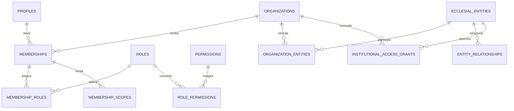
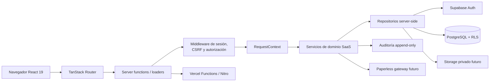
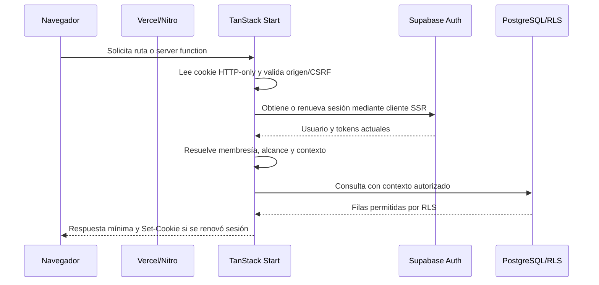
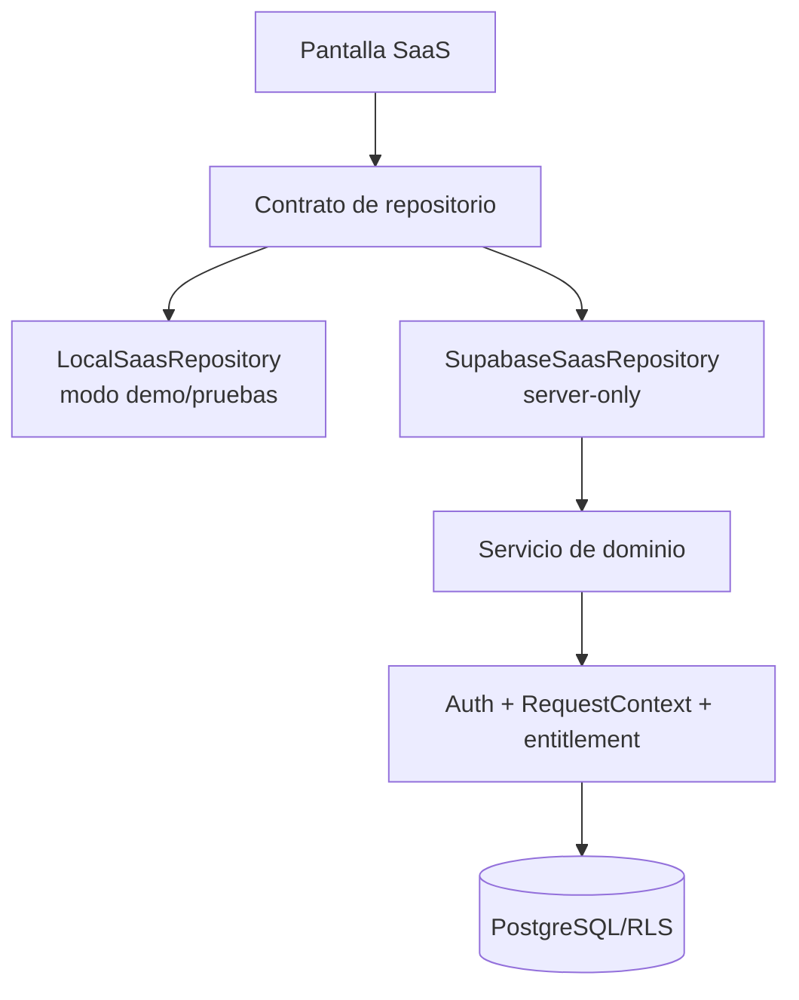

# Arquitectura ejecutable de A&O SaaS con Vercel y Supabase

**Fecha:** 2026-11-07  
**Estado:** revisión arquitectónica y documental; pendiente de aprobación para implementación.  
**Alcance:** A&O SaaS y su CRM Comercial con IA. No se modifican aplicaciones, dependencias, configuraciones, migraciones ni servicios externos.

## 1. Resumen ejecutivo

A&O SaaS existe actualmente como una consola frontend de demostración construida con React 19, TypeScript, Vite, TanStack Router/Start y el preset de Vite de Lovable. Sus entidades se administran mediante `LocalSaasStore` y `localStorage`. No hay cliente Supabase, autenticación Supabase, migraciones, RLS ejecutado, variables de entorno, proyecto Supabase ni carpeta `src/server` propia de SaaS.

La arquitectura objetivo es viable con Vercel como destino de frontend y servidor, TanStack Start para SSR y server functions, Supabase Auth para identidad, PostgreSQL para persistencia y RLS como defensa de aislamiento. La compatibilidad documentada por los proveedores no equivale todavía a una validación del repositorio: antes de implementar deben comprobarse el preset actual de Lovable, la salida Nitro, las cookies SSR, las funciones server-side, las variables de Vercel y la compatibilidad de runtime.

La primera implementación debe conservar el modo demostración, introducir contratos de repositorio y migrar un dominio a la vez. No se debe exponer una clave secreta en el navegador ni usar `localStorage` como autenticación o autorización.

## 2. Estado actual del repositorio

### 2.1 Estado Git

- Rama actual: `design/saas-dashboard-refresh`.
- Seguimiento remoto: `origin/design/saas-dashboard-refresh`.
- Último commit: `5884ae9 feat: actualiza ecosistema completo A&O ERP`.
- Cambios locales presentes antes de esta tarea y preservados:
  - `apps/diocesano/src/routeTree.gen.ts` figura modificado en Git; la revisión previa determinó que no contiene una diferencia funcional útil respecto de `HEAD`.
  - `apps/saas/src/test/setup.ts` contiene el ajuste previo para proporcionar `localStorage` en Vitest.
  - `docs/arquitectura/backend/09-informes-institucionales-y-comunicaciones.md` y `docs/arquitectura/backend/10-preparacion-tecnica-implementacion-saas.md` son documentos locales no confirmados.
- Esta tarea crea únicamente este documento 11.
- No se realizaron commits, push, merge, rebase, limpieza ni restauración de cambios.

### 2.2 Aplicaciones y paquetes

| Área | Evidencia | Estado para la integración SaaS |
|---|---|---|
| `apps/saas` | `src/router.tsx`, `src/routes`, `src/components`, `src/data` | Frontend y modo demo; no tiene `src/server`. |
| `apps/erp` | `src/start.ts`, `src/server.ts`, middleware CSRF y manejo SSR | Tiene infraestructura server-side de referencia; su dominio no debe mezclarse con SaaS. |
| `apps/diocesano` | Aplicación separada con sus rutas | Se conserva fuera del alcance de implementación SaaS. |
| `packages/utilities` | Utilidades de clases y presentación | No contiene dominio, persistencia ni seguridad. |
| `supabase/` | Directorio inexistente | No hay CLI configurada, migraciones, seeds ni pruebas SQL. |

### 2.3 Versiones instaladas relevantes

Las versiones declaradas para SaaS son:

| Componente | Versión declarada |
|---|---:|
| React / React DOM | `^19.2.0` |
| `@tanstack/react-router` | `1.170.41` |
| `@tanstack/react-start` | `1.168.60` |
| Vite | `8.1.5` |
| TypeScript | `^5.8.3` |
| Vitest | `^4.1.10` |
| `@lovable.dev/vite-tanstack-config` | `2.26.5` |

La configuración de SaaS usa `defineConfig({})` del preset de Lovable. No existe `vercel.json` en la línea base revisada ni una prueba de despliegue en Vercel. El `bun.lock` pertenece al estado actual del monorepo y no se modifica en esta tarea.

### 2.4 Persistencia actual

`apps/saas/src/data/saas-repository.ts` contiene:

- `LocalSaasStore` con estado inicial en memoria.
- Persistencia local bajo una clave de `localStorage`.
- Repositorios de entidades para clientes, organizaciones, instituciones, usuarios, membresías, roles, permisos, planes, contratos, suscripciones, licencias, entitlements, límites, facturas, pagos y tickets.
- Repositorios locales adicionales para soporte y registros de módulos.
- Suscripciones React para refrescar las tablas cuando cambia el almacén local.

Este diseño es útil para demostración y pruebas, pero no ofrece autenticación, aislamiento entre tenants, durabilidad, concurrencia, auditoría server-side ni control de acceso real.

## 3. Decisiones consolidadas y límites de producto

### 3.1 Decisiones que se consideran objetivo arquitectónico

- PostgreSQL administrado por Supabase como backend previsto.
- Supabase Auth para identidad.
- TanStack Start para SSR, server functions y middleware.
- RLS en tablas expuestas y autorización server-side complementaria.
- Paperless-NGX como gateway documental futuro, nunca como fuente de verdad de A&O.
- Migraciones SQL versionadas, separadas por ambientes.
- Los fixtures y el modo `localStorage` permanecen durante la transición.

Estas decisiones continúan siendo propuestas de arquitectura hasta que se aprueben proveedor, región, costos, tratamiento de datos y ambientes.

### 3.2 Responsabilidades

| Producto | Responsabilidad | Fuera de su responsabilidad |
|---|---|---|
| A&O SaaS | Clientes comerciales, organizaciones contratantes, instituciones beneficiarias, aplicaciones, módulos, planes, contratos, suscripciones, licencias, entitlements, límites, facturación, pagos, aprovisionamiento, soporte y administración de plataforma | Operación contable, sacramental o pastoral de una institución |
| CRM Comercial con IA | Prospectos, contactos, oportunidades, embudos, actividades, productos y servicios, cotizaciones, campañas, conversaciones y agentes de IA | Autoridad sobre datos operativos del ERP |
| A&O ERP | Operación administrativa, financiera, contable, pastoral y sacramental de la institución contratante | Catálogo comercial, contratos y licenciamiento de A&O |
| A&O Diocesano | Recepción de informes autorizados, seguimiento, revisión documental, consolidación permitida y comunicaciones institucionales | Administración de parroquias o modificación de sus registros originales |

El CRM pertenece a la evolución de SaaS. No debe desarrollarse como un producto aislado con una integración posterior que duplique contactos, organizaciones o historial comercial.

## 4. Modelo de identidad y multi-tenancy

### 4.1 Conceptos

- **Cuenta comercial:** relación comercial de A&O Technologies con un cliente o contraparte; no es una institución eclesial.
- **Organización contratante:** tenant comercial que contrata aplicaciones, módulos o servicios.
- **Entidad eclesial:** diócesis, parroquia, congregación, comunidad religiosa, seminario, fundación u otra institución que puede beneficiarse o relacionarse con una organización.
- **Membresía:** pertenencia de un usuario a una organización dentro de un estado y periodo determinados.
- **Alcance:** límite adicional de una membresía sobre una o varias entidades, instituciones, módulos o funciones.
- **Relación institucional:** vínculo canónico, jurisdiccional, operativo o comercial descriptivo; no concede permisos automáticamente.

Una entidad eclesial puede relacionarse con una o más organizaciones mediante una tabla de vínculo explícita. No se impone una jerarquía única ni se deriva acceso solo porque exista una relación diocesana, canónica o comercial.

### 4.2 Modelo conceptual



### 4.3 Resolución de contexto

1. El navegador solicita un contexto activo, pero solo lo propone.
2. El servidor valida la sesión y obtiene el usuario real.
3. El servidor comprueba la membresía vigente, sus fechas y estado.
4. Se valida el rol, el permiso, el entitlement y el alcance solicitado.
5. Se comprueba la relación explícita con la entidad o institución.
6. Se crea un `RequestContext` inmutable para la operación.
7. La consulta se ejecuta con filtros de tenant y RLS.
8. Un cambio de contexto vuelve a ejecutar todos los pasos; no reutiliza autorización del contexto anterior.

El servidor debe rechazar una membresía suspendida o vencida aunque el JWT siga siendo válido. La expiración o revocación de permisos debe forzar renovación de sesión o una comprobación server-side actualizada.

## 5. Contradicciones y decisiones no consolidadas

| Tema | Documentos involucrados | Consecuencia | Tratamiento propuesto, no aprobado |
|---|---|---|---|
| Modelo institucional | El documento 02 usa `institutions`, `dioceses`, `parishes` y membresías institucionales; los documentos 09 y 10 agregan `organizations`, `ecclesial_entities`, `organization_entities` y grants | Implementar el modelo antiguo puede imponer una jerarquía eclesial única o conceder acceso por relación | Adoptar `ecclesial_entities` y vínculos/grants explícitos; conservar tipos de entidad y relaciones canónicas como datos descriptivos. |
| Destino de despliegue | El documento 07 describe una salida Nitro/Cloudflare no validada para Vercel; la Tarea 008 fija Vercel como infraestructura prevista | El preset actual puede compilar para otro runtime o cambiar la forma de manejar cookies/secretos | Validar una rama de prueba con Nitro/Vercel antes de elegir configuración productiva. |
| Modelo comercial | Los documentos 01–10 describen planes, contratos, licencias y entitlements, pero no consolidan completamente `parties`, asignaciones multi-beneficiario, impuestos, pagos parciales y notas crédito | La facturación y la conversión CRM pueden producir cardinalidades incompatibles | Mantener la ampliación comercial como decisión de diseño previa a migraciones; no asumir contratación centralizada, independiente o mixta. |
| Cliente SSR Supabase | Los documentos proponen `@supabase/ssr`; la documentación oficial lo marca como beta y con API susceptible de cambios | Cambios de versión pueden afectar cookies y renovación | Fijar versión después de una prueba de compatibilidad y encapsularlo detrás de `auth/`. |
| Compartición de servicios | El documento 05 permite tipos/contratos compartidos, pero mantiene servicios por producto | Compartir servicios puede mezclar permisos de SaaS, ERP y Diocesano | Compartir solo tipos y contratos estables; conservar servicios y repositorios por bounded context. |
| Informes y comunicaciones | El documento 09 deja pendientes comunicación entre instituciones, plantillas globales, retención y contratos multi-beneficiario | No se puede cerrar RLS ni retención sin esas decisiones | Mantener el documento 09 como diseño pendiente; no crear tablas hasta aprobar los puntos abiertos. |

## 6. Arquitectura Vercel + TanStack Start + Supabase



### 6.1 Compatibilidad documentada

La documentación oficial de TanStack indica que TanStack Start puede desplegarse en Vercel mediante Nitro y que Vercel puede detectar el framework. La documentación también diferencia server functions, middleware y server routes. La configuración actual del proyecto utiliza el preset de Lovable, que encapsula parte de Vite/Nitro; por eso no se debe añadir manualmente otro plugin hasta validar el output real.

La documentación oficial de Supabase indica que SSR requiere sesiones en cookies, que el flujo PKCE es el apropiado para SSR y que `@supabase/ssr` encapsula el ciclo de vida de cookies. También advierte que el paquete puede tener cambios de API. Estas afirmaciones son compatibilidad del stack documentada, no una prueba de que la combinación instalada en este repositorio ya funcione con Supabase.

Referencias primarias revisadas:

- [TanStack Start: hosting y Vercel](https://tanstack.com/start/latest/docs/framework/react/guide/hosting)
- [TanStack Start: server functions](https://tanstack.com/start/latest/docs/framework/react/guide/server-functions)
- [TanStack Start: middleware](https://tanstack.com/start/latest/docs/framework/react/guide/middleware)
- [Supabase: SSR Auth](https://supabase.com/docs/guides/auth/server-side)
- [Supabase: paquetes de servidor](https://supabase.com/docs/guides/auth/choosing-a-server-package)
- [Vercel: despliegue de TanStack Start](https://vercel.com/kb/guide/deploy-a-tanstack-start-app-to-vercel)

### 6.2 Cliente navegador y cliente servidor

| Cliente | Ubicación | Puede usar | No puede usar |
|---|---|---|---|
| Cliente browser | Código enviado al navegador | URL pública, clave publicable, operaciones de sesión permitidas y datos filtrados por RLS | Clave secreta, `service_role`, conexión directa privilegiada, reglas de autorización confiadas al cliente |
| Cliente server-side | `apps/saas/src/server` | Cookies SSR, sesión, repositorios, servicios y variables privadas | Exponer secretos en respuestas, bundles o logs |
| Gateway privilegiado excepcional | Servicio server-only y auditado | Operaciones administrativas justificadas | Saltarse RLS habitualmente o actuar sin contexto y auditoría |

No se recomienda usar un cliente privilegiado para resolver errores de autorización. RLS y autorización de negocio deben funcionar conjuntamente.

### 6.3 Flujo SSR y sesión



El flujo debe contemplar:

- PKCE y callback de intercambio de código.
- Cookies `HttpOnly`, `Secure`, `SameSite` y dominio restringido según ambiente.
- Renovación de sesión sin cachear respuestas autenticadas entre usuarios.
- Cierre de sesión que invalide la sesión local y provoque revalidación.
- Recuperación de contraseña y verificación de correo mediante callbacks controlados.
- Protección CSRF para server functions y validación de origen.
- Revocación de membresía y cambios de contexto verificados server-side.
- Prohibición de datos de autorización provenientes de `user_metadata` editable.

## 7. Estructura definitiva propuesta para SaaS

La estructura siguiente es objetivo y no se crea en esta tarea:

```text
apps/saas/src/
  routes/                         rutas, loaders y composición de pantallas
  components/                     componentes visuales
  data/
    saas-domain.ts                tipos demo y contratos transitorios
    saas-repository.ts            adaptador local durante la transición
  server/
    auth/                          cliente SSR, callbacks y sesión
    context/                       RequestContext y resolución de alcance
    db/                            cliente Supabase server-only
    repositories/                  persistencia por agregado
    services/                      reglas de dominio SaaS/CRM
    functions/                     createServerFn y contratos RPC
    schemas/                       validación de entradas y salidas
    integrations/                  Paperless u otros gateways server-only
    audit/                         eventos y trazabilidad
  test/
    unit/
    integration/
    security/

packages/domain/                  tipos y contratos sin UI ni persistencia
  identity/
  organizations/
  commercial/
  crm/
  audit/

supabase/                          se crea solo después de aprobación
  config.toml
  migrations/
  seed/
  tests/
```

`src/data` puede conservar fixtures, tipos demo y el adaptador local. Auth, contexto, repositorios productivos, servicios, validación de seguridad, auditoría e integraciones deben vivir en `src/server`.

`packages/domain` es conveniente para IDs, estados, DTOs y contratos compartidos entre productos. No debe contener clientes Supabase, acceso a `localStorage`, servicios de negocio ni permisos específicos de ERP, Diocesano o SaaS.

## 8. Estrategia de migración desde `LocalSaasStore`



1. Inventariar las operaciones reales que usan las rutas y pantallas.
2. Definir interfaces por agregado sin cambiar todavía el comportamiento demo.
3. Encapsular el adaptador actual como `LocalSaasRepository`.
4. Añadir pruebas unitarias contra la interfaz usando datos sintéticos.
5. Implementar el servicio server-side de identidad y organizaciones.
6. Implementar el repositorio Supabase detrás de ese servicio.
7. Cambiar una ruta por dominio mediante una feature flag o selección de proveedor explícita.
8. Comparar estados, errores, filtros, relaciones y resultados de recarga.
9. Migrar comercial, licencias, soporte y CRM de forma independiente.
10. Mantener una etiqueta visible de modo demostración y rechazar cualquier mezcla automática de fixtures con datos productivos.

Tratamiento de concurrencia:

- No declarar éxito hasta recibir confirmación de la mutación server-side.
- Usar identificadores UUID generados server-side.
- Usar versiones o `updated_at` para detectar edición obsoleta.
- Aplicar restricciones únicas e idempotencia en operaciones sensibles.
- Traducir errores de validación, autorización, conflicto, no encontrado e indisponibilidad a estados de UI distintos.

## 9. Seguridad y RLS

### 9.1 Reglas

- Toda tabla en un esquema expuesto debe tener RLS habilitado.
- Toda mutación debe validar usuario, membresía, tenant, alcance, entitlement y estado del recurso.
- `UPDATE` requiere políticas `SELECT`, `USING` y `WITH CHECK` coherentes.
- Las claves foráneas o restricciones compuestas deben impedir referencias cruzadas entre organizaciones cuando el dominio lo requiera.
- Los estados terminales y eventos históricos deben ser inmutables o corregirse mediante eventos compensatorios.
- Las vistas autenticadas deben usar invocación segura y permisos explícitos; no deben asumirse protegidas por RLS automáticamente.
- Las funciones `SECURITY DEFINER` solo pueden existir en esquema no expuesto, con `search_path` restringido, permisos mínimos y justificación auditada.
- Storage debe ser privado y las políticas deben validar el registro padre, no solo el nombre del archivo.
- Los logs y auditoría deben evitar tokens, secretos y datos personales innecesarios.

### 9.2 Matriz de operación

| Dominio | SELECT | INSERT/UPDATE | DELETE |
|---|---|---|---|
| Perfiles | Propio o administrador autorizado | Propio limitado o servidor | No físico ordinario |
| Membresías | Propio o administrador del tenant | Administrador/invitación autorizada | Suspensión lógica |
| Organizaciones y entidades | Membresía y alcance | Rol administrativo | Lógico y condicionado |
| Planes y catálogo | Operador SaaS | Operador SaaS | Nunca si hay contratos |
| Contratos, licencias y entitlements | Organización autorizada + rol comercial | Servicio comercial autorizado | Ajuste/terminación, no borrado histórico |
| Facturación y pagos | Rol financiero del tenant | Servicio financiero | Nunca físico ordinario |
| CRM | Organización propietaria y alcance comercial | Rol CRM | Lógico, con historial |
| Soporte | Participante, responsable o administrador | Servicio de soporte | Lógico |
| Auditoría | Auditoría autorizada | Solo servidor | Nunca |

### 9.3 Pruebas negativas obligatorias

Con dos organizaciones, varias instituciones y usuarios con membresías diferentes, probar:

1. Un usuario de la organización A no lee filas de B.
2. Alterar `organization_id` o `entity_id` en la entrada no cambia el contexto efectivo.
3. Un usuario con alcance institucional limitado no lee otra institución de la misma organización.
4. Una relación diocesana sin `institutional_access_grant` no concede acceso operativo.
5. Una membresía suspendida o vencida no puede leer ni mutar datos privados.
6. Un contrato o licencia de otra organización no habilita módulos.
7. Un usuario no puede reasignar una fila a otro tenant mediante `UPDATE`.
8. Un archivo privado no se descarga sin permiso sobre su registro padre.
9. Un evento de auditoría no puede editarse ni eliminarse.
10. Ninguna clave secreta aparece en el bundle, respuesta HTTP, logs o variables `VITE_*`.

La autorización server-side y RLS son capas complementarias; ninguna se considera sustituto de la otra.

## 10. Migraciones, ambientes y operación

### 10.1 Ambientes

| Ambiente | Proyecto | Datos | Secretos | Uso |
|---|---|---|---|---|
| Desarrollo | Supabase separado | Sintéticos y fixtures explícitos | Propios de desarrollo | Iteración de esquema y servicios |
| Pruebas | Supabase separado | Sintéticos controlados | Propios de pruebas | Integración, RLS y regresión |
| Producción | Supabase separado | Datos reales | Gestor de secretos | Operación institucional |

No se deben compartir claves, cookies, bases ni Storage entre ambientes.

### 10.2 Orden

1. Extensiones y esquemas privados aprobados.
2. Perfiles y vínculo controlado con Auth.
3. Organizaciones, entidades y vínculos.
4. Membresías, roles, permisos, scopes y grants.
5. Auditoría y seguridad base.
6. Aplicaciones, módulos, planes y catálogo.
7. Contratos, suscripciones, licencias, asignaciones y entitlements.
8. Facturas, impuestos, pagos, asignaciones y notas crédito.
9. CRM.
10. Informes, comunicaciones y archivos según aprobación del documento 09.
11. Índices, políticas RLS, pruebas negativas y observabilidad.

Cada migración debe tener nombre con timestamp y descripción, dependencias claras, restricciones, índices, políticas, estrategia de rollback lógico y compatibilidad hacia atrás. Las seeds de prueba no deben ser una importación implícita de `initialSaasState`.

### 10.3 Respaldo y recuperación

Antes de producción deben aprobarse frecuencia, retención, cifrado, región, exportación, prueba de restauración y procedimiento de recuperación. Los documentos privados requieren además política de retención, eliminación legal y auditoría de descargas.

## 11. Estrategia de pruebas

### Antes de conectar Supabase

- `typecheck`, `lint`, pruebas y build de SaaS.
- Unitarias de adaptadores locales, contratos, validaciones y transiciones.
- Verificación del bundle para detectar variables privadas o imports server-only en cliente.
- Prueba de build con el preset actual sin añadir plugins duplicados.

### En desarrollo

- Cliente SSR y callbacks de Auth.
- Cookies, PKCE, renovación, cierre y recuperación.
- Server functions con CSRF y autorización.
- CRUD por dominio, errores de red y conflictos de concurrencia.

### En pruebas

- Integración contra proyecto aislado.
- RLS positiva y negativa.
- Dos organizaciones, varias instituciones, múltiples membresías y diferentes alcances.
- Licencias, entitlements, límites y membresías suspendidas.
- Auditoría, archivos privados y no exposición de secretos.

### Antes de producción

- Build reproducible para Vercel/Nitro.
- Variables de preview y producción separadas.
- Verificación de rutas SSR y server functions en Vercel.
- No cachear respuestas autenticadas con cookies de otro usuario.
- Prueba de rollback de aplicación y restauración de datos.
- Observabilidad, alertas, límites, backups y runbook operativo.

## 12. Plan de implementación por fases

| Fase | Entregable | Criterio de salida |
|---|---|---|
| 0 | Aprobación de proveedor, región, plan, datos y despliegue | Decisiones bloqueantes aprobadas y secretos definidos |
| 1 | Spike de Vercel/TanStack Start | Build, SSR, server function, cookie y variable privada verificadas |
| 2 | Cliente Supabase y Auth SSR | PKCE, callback, renovación, cierre y recuperación probados |
| 3 | Identidad y contexto | Organizaciones, entidades, membresías, roles, scopes y grants con pruebas cruzadas |
| 4 | RLS y auditoría base | Políticas positivas/negativas y eventos append-only |
| 5 | Comercial SaaS | Planes, contratos, licencias, entitlements, facturación y soporte tras repositorios server-side |
| 6 | Migración gradual de UI | Pantallas conectadas por dominio, sin perder modo demo ni estados de error |
| 7 | CRM | Prospectos, contactos, oportunidades y conversión sin duplicados |
| 8 | Informes, comunicaciones y documentos | Documento 09 aprobado, archivos privados y grants verificados |
| 9 | Operación | Backups restaurables, observabilidad, límites, seguridad y runbooks |

## 13. Decisiones pendientes clasificadas

### A. Necesarias antes de implementar

- Confirmar Supabase como proveedor y la región.
- Definir proyectos separados para desarrollo, pruebas y producción.
- Confirmar Vercel como destino y runtime compatible con el preset actual.
- Definir nombres de variables, gestor de secretos y política de exposición.
- Aprobar el modelo de identidad flexible con `ecclesial_entities`, vínculos, scopes y grants.
- Aprobar roles iniciales y la política de membresías multi-organización.
- Resolver la primera fase de CRM y la propiedad de los contactos compartidos.
- Definir si la contratación será centralizada, independiente o mixta.

### B. Necesarias antes de producción

- MFA y política de sesiones.
- Backups, retención, cifrado y recuperación probada.
- Retención documental y almacenamiento privado.
- Integración Paperless-NGX y responsabilidades del gateway.
- Política de auditoría y clasificación de datos sensibles.
- Límites operativos, observabilidad y presupuesto.
- Política de revocación, soporte administrativo y acceso de emergencia.
- Tratamiento de impuestos, pagos parciales, notas crédito y facturación electrónica futura.

### C. Evolutivas

- SSO empresarial.
- Integración DIAN.
- Automatizaciones avanzadas del CRM.
- Escalamiento regional, réplicas y optimización de costos.
- Búsqueda documental avanzada y OCR.
- Analítica de uso y agentes de IA con políticas de datos.
- Exportación avanzada y portabilidad hacia otro proveedor.

## 14. Riesgos técnicos

1. `localStorage` no ofrece seguridad ni aislamiento; no puede continuar como fuente productiva.
2. SaaS no tiene aún server functions propias, cliente SSR ni middleware de identidad.
3. El preset de Lovable oculta parte de la configuración Vite/Nitro; añadir configuración manual puede romper el build.
4. TanStack Start y `@supabase/ssr` deben fijarse y probarse en las versiones exactas del repositorio; la documentación de `@supabase/ssr` advierte cambios de API.
5. Una mala configuración de cache en Vercel puede reutilizar respuestas autenticadas o cookies renovadas entre usuarios.
6. RLS incompleto puede producir exposición aunque la UI o el middleware aparenten restringir el acceso.
7. Claims obsoletos pueden conservar permisos después de una revocación si no se valida el estado actual server-side.
8. El modelo comercial aún no resuelve todas las cardinalidades de contratación multi-beneficiario y facturación.
9. Informes, comunicaciones y archivos tienen decisiones abiertas de retención, publicación, destinatarios y permisos.
10. Compartir servicios de ERP, SaaS y Diocesano sin contexto propio puede mezclar responsabilidades y datos.

## 15. Criterios de aceptación para iniciar implementación

La implementación puede comenzar cuando:

- Se aprueben proveedor, región, proyectos por ambiente y destino Vercel.
- Se confirme el spike de build/SSR/server functions con TanStack Start y el preset actual.
- Se aprueben convenciones de secretos y variables sin valores en Git.
- Se apruebe el modelo flexible de organizaciones, entidades, membresías, scopes y grants.
- Se defina la primera migración de identidad y las pruebas RLS negativas.
- Se aprueben roles iniciales, MFA diferido o requerido y política de sesiones.
- Se delimite la primera fase de comercial SaaS y CRM.
- Se apruebe la estrategia de repositorios local/Supabase y el criterio visible de modo demo.
- Se confirme que no se importarán fixtures automáticamente a producción.
- Se disponga de un ambiente de pruebas aislado y un plan de respaldo/recuperación.

## 16. Resultado de la tarea

Se revisaron los documentos de arquitectura 01 a 10, el estado Git, los manifiestos de paquetes, el lockfile, la configuración de SaaS, el repositorio local y la ausencia de integración Supabase.

Se creó únicamente este documento 11. No se modificaron aplicaciones, `package.json`, `bun.lock`, Vite, TanStack, TypeScript, variables de entorno, configuración de despliegue ni archivos SQL. No se instaló ninguna dependencia, no se creó un proyecto Supabase, no se conectó ningún servicio, no se ejecutaron migraciones y no se realizaron operaciones Git destructivas.

La Tarea 009 no se inicia automáticamente. La siguiente acción requiere aprobación expresa de las decisiones clasificadas como bloqueantes.
