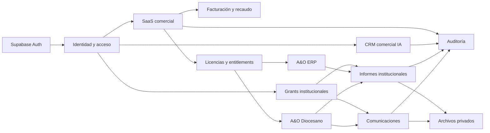
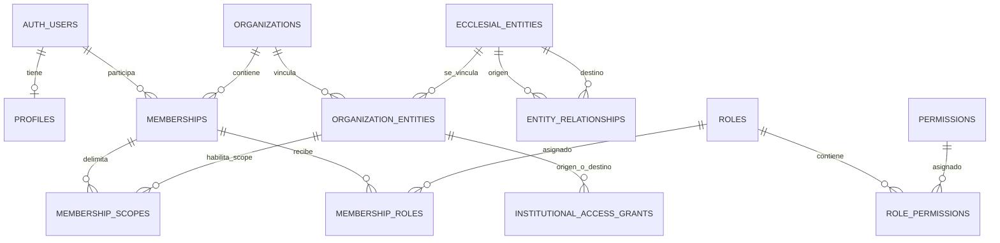
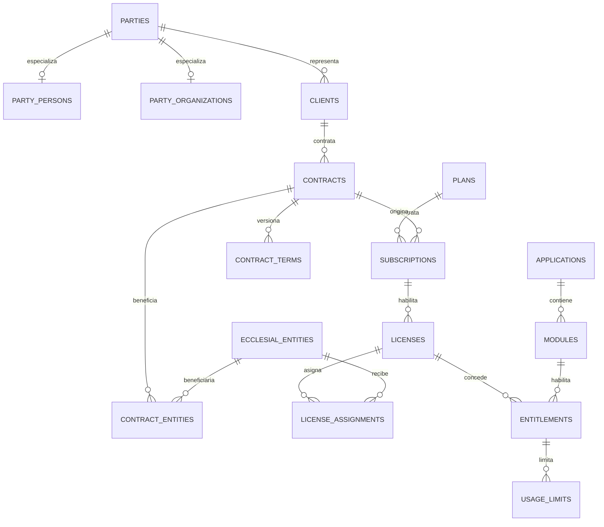
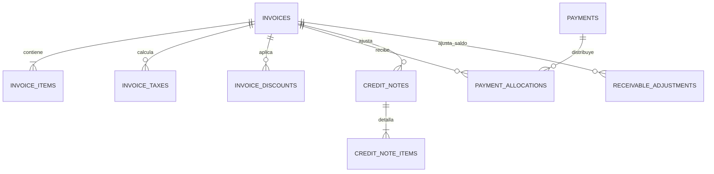
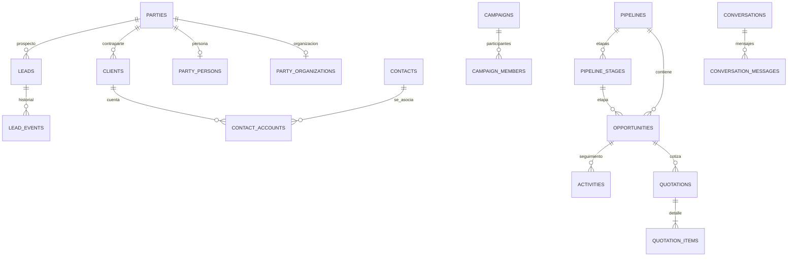
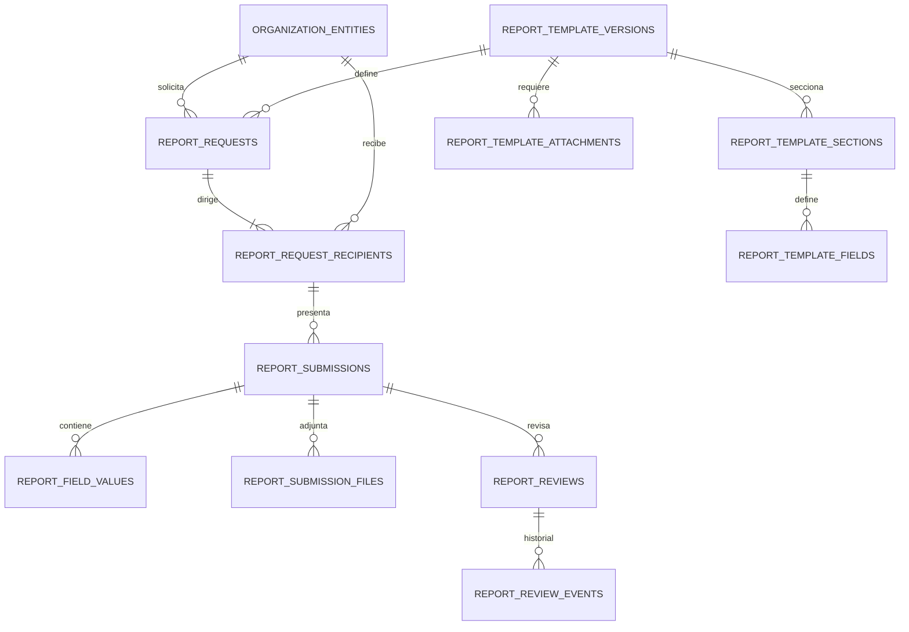
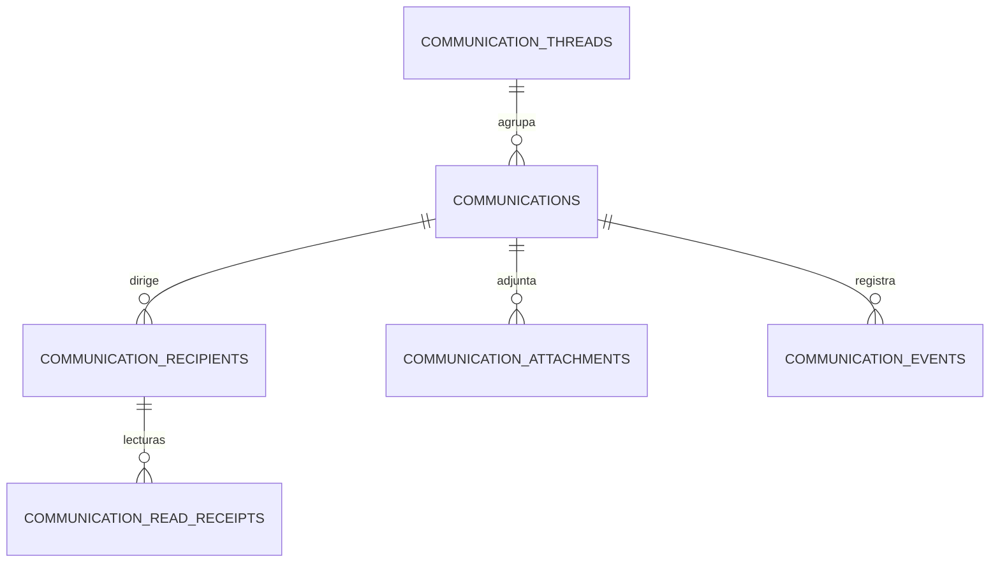

# Modelo relacional maestro — Ecosistema A&O

**Versión:** 0.1 — 2026-11-08  
**Estado:** propuesta estructurada para revisión y aprobación; no es una migración SQL.  
**Repositorio:** Jadiaza/ao-erp  
**Rama:** design/saas-dashboard-refresh  
**Documento rector:** `12-diccionario-maestro-de-datos.md`

---

## 1. Objetivo y autoridad

Este documento convierte el diccionario 12 en un modelo relacional lógico organizado por dominios. Define entidades, claves, relaciones, cardinalidades y restricciones de integridad que deberán reflejarse en el ERD y, después de aprobación, en PostgreSQL.

La autoridad documental queda fijada:

- El documento 12 es la referencia canónica de datos.
- El documento 09 aporta la especificación funcional vigente de informes, comunicaciones, grants y archivos institucionales. Su cierre de integridad 006.1 está incorporado.
- El documento 11 gobierna la arquitectura técnica de ejecución, autenticación, server-side, RLS y despliegue.
- El modelo institucional del documento 02 está superado. No se implementan en paralelo `institutions`, `dioceses`, `parishes`, `institution_memberships` ni `active_institution_contexts`.

Este modelo no convierte decisiones pendientes en hechos. Las cardinalidades marcadas como provisionales requieren aprobación antes del esquema físico. No se crean tablas, migraciones, proyectos Supabase ni conexiones en esta tarea.

## 2. Convenciones relacionales

| Convención | Regla |
|---|---|
| Motor objetivo | PostgreSQL administrado por Supabase, sujeto a aprobación de proveedor y región. |
| Claves primarias | UUID generado en base de datos o servidor. |
| Nombres | snake_case; tablas en plural; PK `id`; FK con sufijo `_id`. |
| Fechas | `timestamptz` para instantes; `date` para fechas civiles; `daterange` solo si se aprueba su uso. |
| Dinero | `numeric(19,4)` como precisión candidata; moneda ISO 4217 en `char(3)`. Confirmar reglas fiscales/contables. |
| Cantidades | `numeric` con escala definida por dominio; evitar `float` para dinero. |
| Estados | `text` con CHECK o catálogo FK; elegir un solo patrón por dominio durante el diseño físico. |
| Auditoría | `created_at`, `updated_at`; eventos históricos append-only. |
| Borrado | Preferir baja lógica en datos contractuales/institucionales; no borrar físicamente documentos ni eventos con historial. |
| Multi-tenant | Incluir `organization_id` en tablas cuyo propietario/ámbito sea una organización. Usar FK compuestas para impedir referencias cruzadas. |
| Supabase Auth | `auth.users.id` es la identidad externa; no duplicar credenciales en `profiles`. |

Los tipos indicados en las fichas son tipos PostgreSQL candidatos. Cuando el diccionario fuente no fija un atributo, se identifica como propuesta para validación, no como hecho funcional cerrado.

## 3. Modelo de contexto y dominios

El ecosistema se divide en dominios con propiedad clara:

1. **Identidad y acceso:** usuarios, perfiles, organizaciones, entidades eclesiales, membresías, scopes, roles y grants.
2. **SaaS comercial:** contrapartes, clientes, aplicaciones, módulos, planes, contratos, suscripciones, licencias y entitlements.
3. **Facturación y recaudo:** facturas, conceptos, impuestos, descuentos, pagos, aplicaciones, notas crédito y ajustes.
4. **CRM comercial con IA:** prospectos, contactos, cuentas, oportunidades, actividades, cotizaciones, campañas y conversaciones.
5. **Informes institucionales:** plantillas versionadas, solicitudes, destinatarios, presentaciones y revisiones.
6. **Comunicaciones institucionales:** hilos, mensajes, destinatarios, adjuntos y eventos de entrega/lectura.
7. **Archivos y auditoría:** metadatos de archivos y eventos de seguridad, comerciales, institucionales y de acceso sensible.
8. **ERP y Diocesano:** aplicaciones consumidoras de servicios compartidos, pero con sus propios datos operativos y límites de acceso. El modelo operativo completo de ERP no está definido en los documentos backend 01–12 y no se inventa aquí.

## 4. ERD de contexto

## 5. Identidad, organizaciones y autorización

### 5.1 ERD

### 5.2 Tablas y claves

| Tabla | PK | Claves foráneas | Campos base propuestos | Restricciones/observaciones |
|---|---|---|---|---|
| `profiles` | `id` | `id → auth.users.id` | `display_name text`, `avatar_path text null`, `locale text`, timestamps | Una fila por usuario; no almacenar contraseñas ni claims de autorización. |
| `organizations` | `id` | `created_by → auth.users.id null` | `name text`, `slug text`, `status text`, `created_at`, `updated_at` | `slug` único global o por plataforma: decisión de producto. Tenant, no equivale a diócesis/parroquia. |
| `ecclesial_entities` | `id` | autoría opcional a usuario | `entity_type text`, `legal_name text`, `display_name text`, `country_code char(2)`, `tax_identifier text null`, `status text`, timestamps | Catálogo de tipos pendiente. No modelar diócesis/parroquias como tablas separadas. Identificador fiscal debe ser opcional y protegido. |
| `organization_entities` | `id` | `organization_id → organizations`, `ecclesial_entity_id → ecclesial_entities` | `relation_type text`, `status text`, `starts_at timestamptz null`, `ends_at timestamptz null` | UNIQUE (`organization_id, ecclesial_entity_id, relation_type`). UNIQUE auxiliar para FK compuesta. El vínculo no concede acceso. |
| `entity_relationships` | `id` | `source_entity_id`, `target_entity_id` → ecclesial_entities | `relationship_type text`, `valid_from date null`, `valid_to date null`, `status text`, `metadata jsonb null` | Prohibir autorrelación salvo caso de uso expreso. No hereda permisos. Cardinalidad N:M temporal. |
| `institutional_access_grants` | `id` | FKs compuestas a vínculos origen/destino en `organization_entities`; `granted_by → auth.users` | `purpose text`, `allowed_actions text[]`, `starts_at timestamptz`, `ends_at timestamptz null`, `status text`, `revoked_at timestamptz null` | purpose limitado a reports/communications; validar acciones permitidas, vigencia y autorización al ejecutar cada acción. No es membresía ni licencia. |
| `memberships` | `id` | `user_id → auth.users`, `organization_id → organizations` | `status text`, `invited_at timestamptz null`, `joined_at timestamptz null`, `expires_at timestamptz null`, timestamps | UNIQUE (`user_id, organization_id`) si se adopta una membresía activa por usuario/tenant; historial de reingreso se resolvería con eventos o tabla histórica. |
| `membership_scopes` | `id` | `membership_id, organization_id → memberships`; vínculo a `organization_entities` | `scope_type text`, `organization_entity_id uuid null`, `created_at` | Scope institucional debe pertenecer a la misma organización de la membresía. Definir si se admite scope tenant-wide. |
| `roles` | `id` | `organization_id → organizations null` | `code text`, `name text`, `description text null`, `is_system boolean` | Rol global con organization_id NULL requiere índice único parcial; roles tenant únicos por organización. |
| `permissions` | `id` | — | `code text`, `name text`, `description text null`, `domain text` | `code` único. Catálogo administrado por plataforma, no por tenant. |
| `role_permissions` | compuesta | `role_id → roles`, `permission_id → permissions` | `role_id uuid`, `permission_id uuid` | PK compuesta; UNIQUE equivalente. |
| `membership_roles` | `id` | `membership_id → memberships`, `role_id → roles`, `scope_id → membership_scopes null` | `starts_at timestamptz`, `ends_at timestamptz null`, `status text` | Validar que el scope pertenezca a la membresía y el rol sea aplicable al tenant/global. |

### 5.3 Reglas de autorización

- Una membresía es pertenencia a una organización; no concede por sí sola todos los permisos.
- El rol agrupa permisos; el scope delimita recursos; el entitlement habilita el módulo contratado. Son comprobaciones independientes.
- La autorización efectiva se calcula server-side a partir del usuario autenticado, membresía vigente, scope, rol, permiso, estado del recurso y entitlement cuando aplique.
- Las relaciones de `entity_relationships` y `organization_entities` nunca sustituyen un `institutional_access_grant`.
- No usar `user_metadata` editable como fuente de roles o permisos.
- Los grants deben comprobar origen y destino con FKs compuestas a `organization_entities`. El diseño físico deberá resolver cómo representar ambas referencias con alias de FK y claves candidatas.

## 6. SaaS comercial y licenciamiento

### 6.1 ERD

### 6.2 Tablas y claves

| Tabla | PK | Claves foráneas | Campos base propuestos | Reglas |
|---|---|---|---|---|
| `parties` | `id` | — | `party_type text`, `display_name text`, `status text`, timestamps | Identidad comercial canónica. No UNIQUE por nombre. Deduplicación por identificadores verificados y reglas de negocio pendientes. |
| `party_persons` | `party_id` | `party_id → parties` | `given_names text`, `family_names text`, `document_type text null`, `document_number text null`, `email text null`, `phone text null` | Especialización 1:0..1; documento personal con acceso restringido. |
| `party_organizations` | `party_id` | `party_id → parties` | `legal_name text`, `trade_name text null`, `tax_identifier text null`, `country_code char(2)` | Especialización 1:0..1; identificador fiscal sujeto a país. |
| `clients` | `id` | `party_id → parties` | `client_code text`, `status text`, `owner_user_id → auth.users null`, timestamps | Una party puede ser prospecto/cliente según ciclo comercial; evitar duplicar identidad. |
| `applications` | `id` | — | `code text`, `name text`, `status text` | UNIQUE code. Catálogo de productos A&O. |
| `modules` | `id` | `application_id → applications` | `code text`, `name text`, `description text null`, `status text` | UNIQUE (`application_id, code`). |
| `plans` | `id` | `application_id → applications` | `code text`, `name text`, `billing_period text`, `currency char(3)`, `base_price numeric(19,4)`, `status text` | Precios/versiones y composición de módulos deben modelarse con vigencia; detalle de plan pendiente. |
| `contracts` | `id` | `client_id → clients`, `organization_id → organizations null` | `contract_number text`, `status text`, `signed_at timestamptz null`, `starts_at timestamptz`, `ends_at timestamptz null`, timestamps | Cliente pagador/contratante separado de beneficiarios. No asumir uno o varios contratos por tenant sin decisión. |
| `contract_entities` | `id` | `contract_id → contracts`, `ecclesial_entity_id → ecclesial_entities` | `beneficiary_role text`, `starts_at timestamptz`, `ends_at timestamptz null`, `status text` | UNIQUE candidato (`contract_id, ecclesial_entity_id`). Permite múltiples beneficiarios; confirmar si se admite beneficiario no eclesial. |
| `contract_terms` | `id` | `contract_id → contracts` | `version_number int`, `terms jsonb`, `effective_at timestamptz`, `approved_by uuid` | Historial inmutable; UNIQUE (`contract_id, version_number`). JSON solo para snapshot legal/versionado, no para duplicar relaciones. |
| `subscriptions` | `id` | `contract_id → contracts`, `plan_id → plans` | `status text`, `starts_at timestamptz`, `current_period_start timestamptz`, `current_period_end timestamptz`, `cancelled_at timestamptz null` | Cardinalidad contrato-suscripción pendiente: permitir varias suscripciones por contrato como opción extensible, no asumir 1:1. |
| `licenses` | `id` | `subscription_id → subscriptions` | `license_key_hash text null`, `status text`, `starts_at timestamptz`, `ends_at timestamptz null` | No almacenar clave legible si no es necesaria; definir cardinalidad suscripción/licencias. |
| `license_assignments` | `id` | `license_id → licenses`, `ecclesial_entity_id → ecclesial_entities` | `status text`, `starts_at timestamptz`, `ends_at timestamptz null` | Una licencia puede asignarse a entidades beneficiarias según capacidad del plan. |
| `entitlements` | `id` | `license_id → licenses`, `module_id → modules` | `status text`, `starts_at timestamptz`, `ends_at timestamptz null`, `config jsonb null` | La concesión debe derivar de plan/licencia/asignación. Config solo para parámetros tipados/versionados. |
| `usage_limits` | `id` | `entitlement_id → entitlements` | `metric_code text`, `limit_value numeric`, `period text`, `status text` | UNIQUE candidato (`entitlement_id, metric_code, period`). Contadores de consumo y eventos quedan por modelar en fase de medición. |

### 6.3 Proyección de servicios habilitados

`service_entitlements` es una vista lógica derivada de contrato → beneficiario → suscripción → licencia → asignación → entitlement. No se insertan filas manualmente ni se mantiene como fuente independiente.

La proyección efectiva debe devolver como mínimo: organización tenant, entidad beneficiaria, aplicación, módulo, licencia, vigencia y estado. La forma exacta de la vista y el origen de `organization_id` dependen de la decisión de contratación y de la asignación del tenant a la entidad.

## 7. Facturación y recaudo

### 7.1 ERD

| Tabla | PK | FK | Campos base propuestos | Reglas |
|---|---|---|---|---|
| `invoices` | `id` | `client_id → clients`, `contract_id → contracts null`, `organization_id → organizations null` | `invoice_number text`, `issue_date date`, `due_date date null`, `currency char(3)`, `subtotal numeric(19,4)`, `tax_total numeric(19,4)`, `discount_total numeric(19,4)`, `total numeric(19,4)`, `status text` | Número único por emisor/serie; emisor fiscal y jurisdicción por definir. Congelar snapshot de receptor y conceptos emitidos. |
| `invoice_items` | `id` | `invoice_id → invoices`, `module_id → modules null` | `description text`, `quantity numeric(19,4)`, `unit_price numeric(19,4)`, `discount_amount numeric(19,4)`, `tax_amount numeric(19,4)`, `line_total numeric(19,4)` | Líneas históricas no cambian después de emitir; correcciones mediante documento de ajuste. |
| `invoice_taxes` | `id` | `invoice_id → invoices`, `invoice_item_id → invoice_items null` | `tax_code text`, `rate numeric(9,6)`, `taxable_base numeric(19,4)`, `tax_amount numeric(19,4)` | Definir si impuesto se aplica a factura o línea; CHECK para evitar ambos ámbitos simultáneos. |
| `invoice_discounts` | `id` | `invoice_id → invoices`, `invoice_item_id → invoice_items null` | `discount_code text`, `description text`, `amount numeric(19,4)`, `approved_by uuid null` | Descuento aprobado y auditable; evitar modificar el precio del catálogo retroactivamente. |
| `payments` | `id` | `client_id → clients` | `payment_reference text`, `payment_date timestamptz`, `amount numeric(19,4)`, `currency char(3)`, `method text`, `status text` | Registro de recaudo; no equivale a aplicación contable a factura. |
| `payment_allocations` | `id` | `payment_id → payments`, `invoice_id → invoices` | `allocated_amount numeric(19,4)`, `allocated_at timestamptz` | Aplicación N:M con transacción y bloqueo/serialización de saldo; validar misma moneda/cliente cuando aplique. |
| `credit_notes` | `id` | `invoice_id → invoices` | `credit_note_number text`, `issue_date date`, `reason text`, `status text`, `total numeric(19,4)`, `currency char(3)` | No borrar factura original; reglas fiscales/DIAN pendientes. |
| `credit_note_items` | `id` | `credit_note_id → credit_notes`, `invoice_item_id → invoice_items null` | `description text`, `quantity numeric(19,4)`, `unit_amount numeric(19,4)`, `line_total numeric(19,4)` | Mantener referencia a línea original cuando corresponda. |
| `receivable_adjustments` | `id` | `invoice_id → invoices`, `approved_by → auth.users` | `adjustment_type text`, `amount numeric(19,4)`, `reason text`, `status text`, `effective_at timestamptz` | Solo ajustes aprobados afectan saldo; no modificar el total emitido. |

**Regla de saldo:** total emitido − pagos aplicados − notas crédito aplicadas ± ajustes aprobados. El saldo no se mantiene editable por el cliente. Para concurrencia, el servicio debe aplicar asignaciones y validar el saldo dentro de una transacción; un CHECK no puede garantizar sumas entre filas.

## 8. CRM comercial con IA

### 8.1 ERD

### 8.2 Tablas y claves

| Tabla | PK | FK | Campos base propuestos | Reglas |
|---|---|---|---|---|
| `leads` | `id` | `party_id → parties`, `organization_id → organizations` | `source text`, `status text`, `owner_user_id → auth.users`, `created_at`, `converted_client_id → clients null` | Prospecto ligado a identidad canónica; conversión idempotente. No deduplicar por nombre. |
| `lead_events` | `id` | `lead_id → leads`, `actor_user_id → auth.users null` | `event_type text`, `payload jsonb`, `created_at` | Historial append-only; no incluir secretos ni información sensible no necesaria. |
| `contacts` | `id` | `party_id → parties`, `organization_id → organizations` | `status text`, `preferred_channel text null`, timestamps | Relación comercial con persona; datos personales viven en party_persons o perfil protegido. |
| `contact_accounts` | compuesta | `contact_id → contacts`, `client_id → clients` | `relationship_role text`, `is_primary boolean` | PK (`contact_id, client_id`); contacto puede asociarse con varias cuentas. |
| `pipelines` | `id` | `organization_id → organizations` | `code text`, `name text`, `is_default boolean`, `status text` | UNIQUE (`organization_id, code`). |
| `pipeline_stages` | `id` | `pipeline_id → pipelines` | `code text`, `name text`, `position int`, `probability numeric(5,2)`, `is_won boolean`, `is_lost boolean` | UNIQUE (`pipeline_id, code`) y (`pipeline_id, position`). |
| `opportunities` | `id` | `organization_id → organizations`, `client_id → clients`, `pipeline_id → pipelines`, `stage_id → pipeline_stages`, `owner_user_id → auth.users` | `name text`, `amount numeric(19,4) null`, `currency char(3)`, `expected_close_date date null`, `status text` | FK compuesta (`pipeline_id, stage_id`) garantiza que etapa pertenezca al pipeline; tenant consistente en cliente/pipeline. |
| `activities` | `id` | `organization_id → organizations`, `opportunity_id → opportunities null`, `lead_id → leads null`, `owner_user_id → auth.users` | `activity_type text`, `subject text`, `description text null`, `due_at timestamptz null`, `completed_at timestamptz null`, `status text` | Asociación polimórfica debe evitarse si no se define FK. Permitir relación explícita a lead u opportunity; contactos adicionales requieren tabla puente. |
| `products_services` | `id` | `application_id → applications null` | `code text`, `name text`, `description text null`, `unit_price numeric(19,4) null`, `currency char(3) null`, `status text` | Catálogo comercial. Si requiere precio histórico, crear versiones de precio antes de facturar. |
| `quotations` | `id` | `organization_id → organizations`, `client_id → clients`, `opportunity_id → opportunities null` | `quotation_number text`, `issue_date date`, `valid_until date null`, `currency char(3)`, `subtotal numeric(19,4)`, `tax_total numeric(19,4)`, `total numeric(19,4)`, `status text` | Snapshot de receptor y precios; aprobar/aceptar no crea contrato sin acción comercial confirmada. |
| `quotation_items` | `id` | `quotation_id → quotations`, `product_service_id → products_services null` | `description text`, `quantity numeric(19,4)`, `unit_price numeric(19,4)`, `discount numeric(19,4)`, `line_total numeric(19,4)` | Detalle congelado al emitir; descuentos sujetos a permiso. |
| `campaigns` | `id` | `organization_id → organizations`, `owner_user_id → auth.users` | `name text`, `channel text`, `status text`, `starts_at timestamptz null`, `ends_at timestamptz null` | Consentimiento y preferencias de comunicación deben comprobarse antes de enviar. |
| `campaign_members` | `id` | `campaign_id → campaigns`, `party_id → parties` | `status text`, `joined_at timestamptz null`, `responded_at timestamptz null` | UNIQUE (`campaign_id, party_id`). |
| `conversations` | `id` | `organization_id → organizations`, `party_id → parties null`, `lead_id → leads null`, `client_id → clients null` | `channel text`, `status text`, `assigned_user_id → auth.users null`, timestamps | Debe definirse una sola identidad principal o una regla de consistencia entre party/lead/client. |
| `conversation_messages` | `id` | `conversation_id → conversations`, `sender_user_id → auth.users null` | `direction text`, `body text`, `provider_message_id text null`, `sent_at timestamptz null`, `metadata jsonb null` | Retención, consentimiento, cifrado y acceso restringido pendientes. |
| `ai_agents` | `id` | `organization_id → organizations` | `code text`, `name text`, `status text`, `configuration jsonb`, `created_by → auth.users` | Herramientas, permisos, modelo, retención y límites se configuran con allowlist; no dar facultad autónoma para activar licencias, cambiar precios o confirmar ventas. |

### 8.3 Límites de autonomía de IA

La IA puede clasificar prospectos, resumir conversaciones, sugerir acciones y preparar borradores. Toda acción con efecto comercial (precio, descuento, contrato, cobro, licencia, activación o confirmación de venta) requiere validación de reglas y autorización humana/rol habilitado. Registrar agente, herramienta, entrada/salida pertinente, usuario que autorizó y resultado sin guardar secretos.

## 9. Informes institucionales

### 9.1 ERD

### 9.2 Tablas y claves

| Tabla | PK | FK | Campos base y reglas |
|---|---|---|---|
| `report_templates` | `id` | `owner_organization_id → organizations null` | `code, name, description, institution_types text[], periodicity, status`. NULL owner solo si se aprueban plantillas globales. |
| `report_template_versions` | `id` | `template_id → report_templates`, `published_by → auth.users null` | `version_number int, status, published_at, rendering_config jsonb, source_policy jsonb`. UNIQUE(template_id, version_number); versión utilizada no se modifica. |
| `report_template_sections` | `id` | `template_version_id → report_template_versions` | `code, title, position int, description`. UNIQUE(version, code), UNIQUE(version, position). |
| `report_template_fields` | `id` | `section_id → report_template_sections` | `code, label, field_type, is_required bool, is_repeatable bool, position int, validation_schema jsonb, erp_source text null`. UNIQUE(section, code), UNIQUE(section, position). |
| `report_template_attachments` | `id` | `template_version_id → report_template_versions` | `code, label, is_required bool, allowed_mime_types text[], max_size_bytes bigint`. UNIQUE(version, code). |
| `report_requests` | `id` | FK compuesta `requesting_organization_entity_id, requesting_organization_id, requesting_entity_id → organization_entities`; `template_version_id` | `request_number, title, instructions, period_start date, period_end date, published_at, due_at, status`. La entidad solicitante debe corresponder al vínculo explícito de organización. |
| `report_request_recipients` | `id` | `request_id → report_requests`; FK compuesta al vínculo destinatario `organization_entities` | `recipient_organization_entity_id, recipient_organization_id, recipient_entity_id, status`. UNIQUE(request_id, recipient_organization_entity_id). No inferir destinatarios desde directorio. |
| `report_submissions` | `id` | `request_recipient_id → report_request_recipients`, `previous_submission_id → report_submissions null`, `submitted_by → auth.users` | `version_number int, is_current bool, delivery_status, review_status, submission_number, radicado_number null, submitted_at, received_at, correction_requested_by, correction_requested_at`. UNIQUE(recipient, version); índice único parcial recipient WHERE is_current. Versiones inmutables. |
| `report_field_values` | `id` | `submission_id → report_submissions`, `field_id → report_template_fields` | `row_key text null, value_json jsonb, source_system text, source_reference text null`. UNIQUE(submission, field, row_key) con normalización para valores no repetibles. |
| `report_submission_files` | `id` | `submission_id → report_submissions`, `template_attachment_id → report_template_attachments null`, `document_reference_id → document_file_metadata null` | Metadatos de archivo o referencia; definir una única fuente de metadatos y no duplicar binario. |
| `report_reviews` | `id` | `submission_id → report_submissions`, `reviewer_user_id → auth.users`, `reviewer_entity_id → ecclesial_entities null` | `status, summary, created_at`. Una presentación puede tener varias revisiones/historial, según flujo aprobado. |
| `report_review_events` | `id` | `review_id → report_reviews`, `author_user_id → auth.users`, `field_id → report_template_fields null` | `event_type, comment, created_at`. Append-only; conservar observaciones y decisiones. |

### 9.3 Estados independientes

- Solicitud: `draft, published, open, closed, cancelled, archived`.
- Entrega: `draft, submitted, delivered, failed, withdrawn`.
- Revisión: `not_started, in_review, correction_requested, accepted, rejected, closed`.

Recepción técnica, recepción documental y revisión son hitos distintos. El radicado se genera cuando se completa la recepción documental definida por el flujo; una respuesta HTTP exitosa no constituye radicación. Una corrección genera nueva presentación y conserva la anterior.

### 9.4 Reglas de plantilla

Las secciones, campos y adjuntos son la única estructura de formulario. No duplicar el esquema en un JSON general. `rendering_config` solo controla presentación y `source_policy` solo define fuentes de ERP autorizadas. No ejecutar consultas arbitrarias definidas por una plantilla.

## 10. Comunicaciones institucionales

### 10.1 ERD

| Tabla | PK | FK | Campos base y reglas |
|---|---|---|---|
| `communication_threads` | `id` | `owner_organization_id → organizations`, `origin_entity_id → ecclesial_entities`, `created_by → auth.users` | `subject, thread_type, status, created_at, closed_at`. Tipos: particular, circular, convocatoria, notification. |
| `communications` | `id` | `thread_id → communication_threads`, `parent_communication_id → communications null`, `sender_user_id → auth.users`, `sender_entity_id → ecclesial_entities` | `body, allow_replies bool, published_at, status`. Respuestas solo si allow_replies. |
| `communication_recipients` | `id` | `communication_id → communications`, `recipient_entity_id → ecclesial_entities null`, `recipient_organization_id → organizations null`, `recipient_user_id → auth.users null`, `recipient_scope_id → membership_scopes null` | `delivery_status, delivered_at, read_at, archived_at`. Dos variantes: destinatario institucional (user null) o individual (user y scope presentes). CHECK XOR y UNIQUE parciales distintos. |
| `communication_attachments` | `id` | `communication_id → communications`, `document_file_id → document_file_metadata` | Relación al archivo privado; no duplicar storage metadata. |
| `communication_events` | `id` | `communication_id → communications`, `recipient_id → communication_recipients null`, `actor_user_id → auth.users null` | `event_type, metadata jsonb, created_at`. Append-only. |
| `communication_read_receipts` | `id` | `recipient_id → communication_recipients`, `user_id → auth.users` | `read_at, device_metadata jsonb null`. Opcional si se necesita historial de lecturas por usuario. |

**Decisión no asumida:** comunicación entre parroquias/instituciones, respuestas institucionales y política de lectura/confirmación siguen pendientes. El modelo base cubre comunicación emitida desde una organización y dirigida a destinatarios explícitos, sin conceder acceso general entre instituciones.

## 11. Archivos y auditoría

### 11.1 Archivos

| Tabla | PK | FK | Campos base | Reglas |
|---|---|---|---|---|
| `document_file_metadata` | `id` | autor `uploaded_by → auth.users`; referencia de propietario por dominio pendiente de FK explícita | `storage_provider, storage_key, original_name, detected_mime_type, declared_mime_type, size_bytes bigint, checksum_sha256, malware_status, retention_until, deleted_at` | Storage privado. No devolver storage_key ni URL permanente al cliente. La autorización se verifica contra el registro padre. |

Los informes y comunicaciones deben referenciar metadatos de archivo mediante FK, evitando guardar copias divergentes de nombre, MIME, tamaño y checksum en cada tabla hija. La relación polimórfica de propietario no se implementará como FK inexistente: se debe decidir entre tablas puente específicas por dominio o un agregado documental con propietario tipado.

### 11.2 Auditoría

| Tabla | Dominio | PK/FK | Regla |
|---|---|---|---|
| `security_events` | Seguridad y sesión | `id`; actor opcional a auth.users | Append-only, insertado server-side. |
| `commercial_audit_events` | Contratos, cobros, licencias, CRM comercial | `id`; actor y tenant según evento | Append-only; no incluir secretos. |
| `institutional_audit_events` | Informes y comunicaciones | `id`; actor, organización, entidad y recurso | Append-only. |
| `sensitive_access_events` | Lectura/descarga sensible | `id`; actor, recurso, finalidad | Append-only; minimizar metadatos personales. |

No crear además una tabla global `audit_events` sin definir qué responsabilidad no cubren estos cuatro registros. La retención y consulta transversal se resuelven con política/particionado o vista controlada, no duplicando eventos.

## 12. Relaciones entre dominios y propiedad de datos

| Dominio | Fuente de verdad | Consumidores | Límite |
|---|---|---|---|
| Identidad | Supabase Auth | SaaS, ERP, Diocesano, CRM | Auth no administra roles de negocio por metadata editable. |
| Tenant y vínculos | Identidad/organizaciones | SaaS, ERP, Diocesano | Directorio y vínculo no conceden acceso. |
| Contrato, suscripción y licencia | SaaS | Aplicaciones contratadas | ERP no modifica contratos ni concede licencias. |
| CRM comercial | SaaS/CRM | Equipo comercial | Conversaciones CRM no son comunicaciones diocesanas. |
| Operación institucional | A&O ERP | La propia institución | La diócesis no modifica datos originales. |
| Solicitudes y revisión de informes | A&O Diocesano | ERP destinatario | El informe presentado es una copia/versionado, no acceso a tablas originales. |
| Comunicaciones institucionales | A&O Diocesano/emisor autorizado | Destinatarios explícitos | No equivale a mensajería comercial. |
| Auditoría | Cada dominio mediante servicios server-side | Auditoría autorizada | Eventos inmutables; no exponer indiscriminadamente. |

## 13. Restricciones de integridad obligatorias para el diseño físico

1. **Tenant coherente:** las tablas hijas que incluyen `organization_id` deben referenciar mediante FK compuesta al padre con el mismo tenant.
2. **Vínculos institucionales:** `membership_scopes`, `institutional_access_grants`, solicitudes y destinatarios deben referenciar registros reales de `organization_entities`; no basta comparar UUIDs en frontend.
3. **Roles globales:** unicidad mediante índices parciales separados para roles con `organization_id IS NULL` y roles tenant.
4. **Oportunidades:** FK compuesta (`pipeline_id, stage_id`) para asegurar que la etapa pertenece al pipeline; agregar clave UNIQUE auxiliar en pipeline_stages.
5. **Versiones:** unicidad de versión y un único registro vigente mediante índice único parcial.
6. **Facturación:** asignaciones de pagos, notas crédito y ajustes se validan transaccionalmente con bloqueo del saldo y moneda compatible.
7. **Parties:** no usar nombre como identificador único global; deduplicación requiere identificadores verificados y reglas por país.
8. **Comunicación:** CHECK para separar destinatario institucional e individual; índices parciales separados para unicidad.
9. **Archivos:** Storage privado; validar MIME detectado, tamaño, malware, retención y autorización del padre.
10. **Auditoría:** append-only; usuarios finales no pueden actualizar ni borrar eventos.
11. **Estados:** transiciones validadas en servicios y, para invariantes críticos, restricciones/funciones DB.
12. **Borrado:** usar RESTRICT o baja lógica donde exista historia comercial, institucional, financiera o documental.

## 14. Decisiones que siguen abiertas y bloquean el cierre físico

Estas decisiones no se resuelven por inferencia. Se debe mantener el diseño marcado como provisional hasta aprobación:

| ID | Decisión | Efecto en el modelo | Alternativa de trabajo propuesta (no aprobada) |
|---|---|---|---|
| D-01 | Contratación centralizada, independiente o mixta | Cardinalidad de contrato, tenant, entidad beneficiaria, suscripción y licencia | Diseñar con pagador/contratante separado de beneficiarios; admitir múltiples contract_entities y suscripciones, sujeto a aprobación. |
| D-02 | ¿Una organización tenant puede incluir varias entidades eclesiales y quién crea ese vínculo? | Alta de organization_entities y administración del tenant | Permitir N:M con vínculo explícito y flujo de aprobación. |
| D-03 | Roles globales y alcance de membresía | FKs, índices parciales, RLS | Catálogo global + roles tenant; scope tenant-wide o institucional explícito. |
| D-04 | Titularidad de parties/contactos compartidos | CRM, deduplicación, visibilidad | Party canónica separada de relación comercial por tenant; contactos compartidos solo con autorización. |
| D-05 | Plantillas globales de informes | owner_organization_id NULL y publicación jurisdiccional | Propietario de plataforma o institución con publicación explícita/versionada. |
| D-06 | Comunicación entre instituciones y respuestas | grants, destinatarios, permisos y RLS | No habilitarla en la primera versión salvo autorización explícita. |
| D-07 | Retención de informes, comunicaciones y archivos | columnas de retención, Storage, eliminación | Política por categoría documental y obligaciones legales, pendiente de validación. |
| D-08 | Política de lectura institucional | communication_read_receipts y acuses | Diferenciar entrega al buzón institucional de lectura por usuario. |
| D-09 | Facturación e impuestos | emisor, numeración, impuestos, moneda, DIAN, notas crédito | Facturación comercial interna inicial; integración fiscal se define por jurisdicción antes de producción. |
| D-10 | Medición de consumo | eventos/contadores de uso, límites y periodos | Añadir ledger de usage_events antes de cobrar por consumo. |
| D-11 | Archivos y propietario | FKs de report_submission_files y communication_attachments | Tabla maestra de archivos con relaciones puente tipadas por dominio. |
| D-12 | Estados y catálogos | CHECK vs tablas catálogo; transiciones | CHECK para estados cerrados por código; tabla catálogo si administrables. |
| D-13 | Datos ERP operativos | Modelo contable, sacramental, pastoral y documental | No incluir en este ERD hasta recibir y revisar el diccionario funcional ERP. |

## 15. Secuencia para pasar a esquema físico

1. Aprobar el modelo de identidad y relaciones institucionales.
2. Resolver D-01 a D-13 o asignar formalmente qué decisiones quedan fuera de la primera fase.
3. Completar fichas de columnas con nullability, defaults, precisión, collation, checks y ON DELETE.
4. Elaborar ERD físico por dominio y ERD global con todas las FKs compuestas.
5. Definir matriz RLS por tabla y operación, vinculada a scopes, grants y entitlements.
6. Preparar pruebas negativas con dos tenants y varias entidades.
7. Validar modelo con casos de contratación, informes, comunicaciones y CRM.
8. Solo después, generar migraciones PostgreSQL versionadas y seeds sintéticos.

## 16. Criterio de aceptación del modelo relacional

El modelo puede considerarse aprobado para implementación cuando:

- No contiene la familia institucional superada del documento 02.
- La separación tenant/entidad eclesial/grant está implementada sin herencia de permisos.
- Contratación, beneficiarios, suscripciones y licencias tienen cardinalidades aprobadas.
- Cada FK multi-tenant impide cruces entre organizaciones.
- Informes distinguen solicitud, destinatario, versión de entrega, recepción documental y revisión.
- Comunicaciones distinguen destinatario institucional e individual.
- Archivos tienen propietario/relación verificable, almacenamiento privado y control de descarga.
- Facturación conserva documento emitido, aplicaciones de pago y ajustes sin sobrescribir historia.
- CRM y operación ERP no duplican fuentes de verdad.
- Cada tabla tiene política RLS y pruebas positivas/negativas.
- Las decisiones no resueltas permanecen explícitamente fuera de la implementación.

## 17. Alcance de esta versión

Esta versión construye el modelo relacional lógico de los dominios que están especificados en los documentos 01–12. No constituye aprobación automática de todas las alternativas físicas ni sustituye el diccionario funcional operativo de A&O ERP.

No se crearon tablas SQL, migraciones, políticas RLS ejecutables, proyectos Supabase ni cambios de aplicación. No se modificó el modelo frontend demo ni se realizaron operaciones Git destructivas.

**Siguiente hito:** revisión de este modelo y aprobación de decisiones D-01 a D-13. Después se prepara el ERD físico y el paquete de migraciones por fases.
