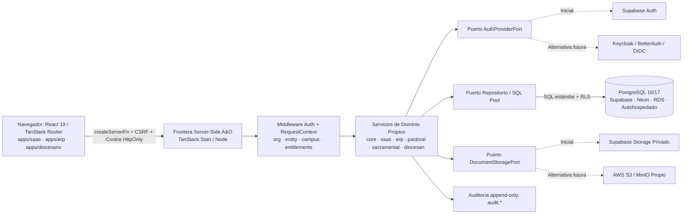

# NIVEL 2.1 — AUDITORÍA TÉCNICA Y PREPARACIÓN DE INFRAESTRUCTURA

**Proyecto:** A&O ERP / A&O SaaS / A&O Diocesano  
**Fecha:** 2026-11-14  
**Estado:** Auditoría técnica y diseño arquitectónico (Nivel 2.1). Pendiente de revisión y aprobación del propietario.  
**Restricción aplicada:** Etapa exclusivamente documental. No se instalaron dependencias, no se modificó código de aplicación ni configuraciones, no se conectó ni creó ningún proyecto Supabase, no se ejecutó SQL ni migraciones y se preservaron íntegros todos los cambios locales previos.

---

## 1. Resumen ejecutivo

La auditoría técnica del repositorio `D:\Proyectos\ao-erp` confirma que las tres aplicaciones (`apps/erp`, `apps/saas` y `apps/diocesano`) operan actualmente como aplicaciones frontend con **persistencia demostrativa local** en `window.localStorage` y datos en memoria. No existe todavía conexión activa a PostgreSQL, Supabase Auth, Supabase Storage, Realtime, Edge Functions ni migraciones SQL ejecutables.

Al mismo tiempo, el ecosistema cuenta con un diseño lógico y relacional avanzado (Documentos `01` a `15` en `docs/arquitectura/backend/` y los informes de cierre de Nivel 1), una frontera inicial de server functions en `apps/erp` (`src/start.ts`, `src/server.ts`, CSRF middleware) y pruebas técnicas recientes en `apps/saas` (`src/server-functions/vercel-runtime.ts`, `src/server-functions/module-access.ts`).

Esta auditoría concluye que **Supabase administrado** (PostgreSQL + Auth + Storage privado) es viable como plataforma inicial para acelerar la salida a producción, **siempre que se adopte una arquitectura desacoplada del proveedor (Decisión D-14)** que garantice:

1. **PostgreSQL estándar** como único motor de verdad, sin lógica de negocio cautiva en Edge Functions ni consultas directas desde componentes React.
2. **Identificador interno propio de usuario** desacoplado del proveedor de identidad (`auth.users`) y validación doble (servicios server-side propios + PostgreSQL RLS).
3. **Interfaz abstracta de almacenamiento (`DocumentStoragePort`)** compatible con Supabase Storage, AWS S3 y MinIO autohospedado, con metadatos en PostgreSQL y sin binarios en la base de datos.
4. **Separación estricta de ambientes** (Desarrollo, Pruebas/Staging y Producción) y verificación previa de compatibilidad del runtime de despliegue (hoy el preset `@lovable.dev/vite-tanstack-config` compila por defecto para `cloudflare-module`).

**Dictamen para Nivel 2.2:** **APTO CON OBSERVACIONES** (requiere aprobación expresa del propietario sobre D-14, las decisiones bloqueantes de Fase 1 del Nivel 1 —D-03, D-12, D-13— y los parámetros de proveedor/región/runtime antes de escribir DDL o conectar servicios).

---

## 2. Estado real de la infraestructura

### 2.1 Inventario por aplicación y paquete

| Componente | Stack verificado | Frontera servidor actual | Persistencia actual | Observación clave |
|---|---|---|---|---|
| `apps/saas` | React `^19.2.0`, TanStack Router `1.170.41`, TanStack Start `1.168.60`, Vite `8.1.5`, `@lovable.dev/vite-tanstack-config` `2.26.5` | Parcial incipiente (`src/server-functions/vercel-runtime.ts` y `module-access.ts` vía `createServerFn`); sin `src/start.ts` ni `src/server.ts` propios | `LocalSaasStore` en `localStorage` (`ao-saas:domain:v1`) y sesión demo local (`ao-saas:auth-session:v1`) | No tiene middleware CSRF propio explícito ni cliente BD/Auth externo |
| `apps/erp` | React `^19.2.0`, TanStack Router `1.170.41`, TanStack Start `1.168.60`, Tailwind CSS `^4.2.1`, Zod `^3.25.76`, `@tanstack/react-query` `^5.101.1`, `nitro` `3.0.260603-beta` | Base SSR y middleware (`src/start.ts` con `createCsrfMiddleware` y `errorMiddleware`; `src/server.ts`) | `useLocalCollection` en `localStorage` (`ao-erp:*` con sufijos `:cristiano`/`:combinado`) | Consume API HTTP externa real solo en Liturgia (`src/lib/ordo/client.ts`); sin BD institucional |
| `apps/diocesano` | React `^19.2.0`, TanStack Router/Start `1.170.41` / `1.168.60`, Vite `8.1.5` | Inexistente | Scaffold mínimo sin módulos conectados | Pendiente de diseño operativo sobre esquemas `diocesan` y `core` |
| `packages/utilities` | TypeScript (`@ao/utilities`) | N/A | N/A | Exporta únicamente `cn()` (`clsx` + `tailwind-merge`); sin dominio ni persistencia |
| `supabase/` | Inexistente | — | — | No existe `config.toml`, `migrations/`, `seed.sql` ni pruebas SQL |
| `.env*` / `vercel.json` | Inexistentes | — | — | No hay archivos de variables de entorno ni manifiesto de despliegue Vercel |

### 2.2 Evidencia de compilación y runtime observada

- **Preset de build (`@lovable.dev/vite-tanstack-config` `2.26.5`)**: los tres `vite.config.ts` delegan en `defineConfig(...)` del preset de Lovable, el cual incorpora `tanstackStart`, `viteReact`, `tailwindcss`, `tsConfigPaths` y `nitro` con destino por defecto **`cloudflare-module`** (`.output/nitro.json`, `.output/server/wrangler.json`).
- **Implicación operativa**: como ya advirtieron los Documentos `12` y `14`, aunque `TanStack Start` y `createServerFn` funcionan en desarrollo y generan SSR + Nitro en build, desplegar en **Vercel** o en servidor Node/Docker propio requiere validar explícitamente el preset Nitro objetivo (`vercel` o `node-server`) antes de pasar a producción.
- **Gestor del workspace**: `Bun 1.2.22` (`bun.lock` en raíz), con scripts separados por aplicación (`dev:*`, `build:*`, `typecheck:*`, `lint:*`, `test:*`).

### 2.3 Resumen de decisiones arquitectónicas previas (D-01 a D-13)

De la revisión de `docs/arquitectura/backend/15-especificacion-fisica-postgresql-saas.md` y de los informes de cierre de Nivel 1 (`informe-nivel-1-cierre-arquitectura-modelo-datos.txt` e `informe-continuacion-nivel-1-cierre-observaciones.txt`), las 13 decisiones identificadas mantienen el siguiente estado:

| ID | Tema | Recomendación documentada en Nivel 1 | Estado actual |
|---|---|---|---|
| **D-01** | Contratación y cardinalidad comercial (`clients`/`contracts`/`contract_entities`) | Separar pagador de beneficiarios; 1..N suscripciones y licencias | Pendiente de aprobación (bloquea comercial) |
| **D-02** | Flujo de alta y aprobación de `core.organization_entities` (N:M) | Alta independiente + vínculo explícito sin herencia automática | Pendiente de aprobación (flujo de vínculo) |
| **D-03** | Catálogo de scopes (`tenant \| entity \| campus`) y roles globales vs. tenant | 1 membresía por `(user_id, organization_id)` + `membership_scopes` + `membership_roles` | **Bloqueante inmediato de Fase 1 BD** |
| **D-04** | Identidad comercial canónica (`saas.parties`) vs. `erp.persons` | `parties` en SaaS/CRM; `erp.persons` separado en ERP | Pendiente de aprobación (bloquea SaaS/CRM) |
| **D-05** | Plantillas de informes diocesanos globales vs. por organización | `owner_organization_id NULL` solo para plataforma; versiones inmutables | Pendiente de aprobación (bloquea Diocesano) |
| **D-06** | `core.institutional_access_grants` y comunicaciones cruzadas | Grants explícitos por finalidad (`reports \| communications`) y vigencia | Pendiente de aprobación (bloquea Diocesano) |
| **D-07** | Metadatos documentales y almacenamiento privado (`document_file_metadata`) | Tabla única de metadatos, Storage privado y URLs firmadas server-side | Pendiente de aprobación (política de retención) |
| **D-08** | Acuses de lectura en comunicaciones (`read_at` vs. `communication_read_receipts`) | `read_at` inicial + tabla histórica opcional | Pendiente de aprobación (bloquea Comunicaciones) |
| **D-09** | Facturación SaaS interna vs. facturación electrónica fiscal (DIAN) | Facturación comercial interna con snapshot; conector fiscal desacoplado | Pendiente de aprobación (emisor/país/impuestos) |
| **D-10** | Medición de consumo (`usage_limits` vs. `usage_events`) | Límites por licencia/entitlement; diferir `usage_events` | Pendiente de aprobación (antes de cobro por uso) |
| **D-11** | Tablas puente documentales tipadas vs. FK polimórfica | Tablas puente específicas con FKs reales (cero polimorfismos sin FK) | Pendiente de aprobación (bloquea Documentos) |
| **D-12** | Catálogo cerrado de estados (`CHECK`) vs. tablas catálogo | `text` con `CHECK` para estados cerrados; catálogo solo configurables | **Bloqueante inmediato de Fase 1 BD** |
| **D-13** | Alcance del modelo operativo A&O ERP (`erp`, `pastoral`, `sacramental`) | Incluir diseño SQL operativo ERP unido por `organization_id`/`campus_id` | **Bloqueante inmediato de Nivel 2** |

*(Ninguna de estas decisiones ha sido alterada o reemplazada en esta auditoría; todas permanecen a la espera de aprobación formal del propietario).*

---

## 3. Dependencias encontradas

### 3.1 Dependencias de Supabase, PostgreSQL y almacenamiento en código y manifiestos

La inspección exhaustiva de `package.json` (raíz, `apps/erp`, `apps/saas`, `apps/diocesano`, `packages/utilities`) y del código fuente bajo `apps/` arroja:

| Categoría | Paquetes / Configuraciones encontradas | Estado real |
|---|---|---|
| `@supabase/supabase-js` / `@supabase/ssr` | **0 coincidencias** en `package.json` y en `src/` | No instalados ni importados |
| Clientes PostgreSQL (`pg`, `postgres`, `drizzle-orm`, `prisma`, `@prisma/client`) | **0 coincidencias** | No instalados ni importados |
| Clientes S3 / MinIO (`@aws-sdk/client-s3`, `minio`) | **0 coincidencias** | No instalados ni importados |
| Supabase Auth / Storage / Realtime / Edge Functions | **0 usos activos** en runtime | Solo mencionados en documentación (`docs/arquitectura/backend/*`) y comentarios de diseño (`provisioning-service.ts`, `support-demo.ts`, `lovable-error-reporting.ts`) |
| Variables de entorno (`SUPABASE_*`, `DATABASE_URL`, `PAPERLESS_*`, `.env*`) | **0 archivos `.env`** | Solo `AO_SAAS_SPIKE_SECRET` y `VERCEL` leídas en `apps/saas/src/server-functions/vercel-runtime.ts`, más `VITE_DISABLE_DEMO_ACCOUNT` en `apps/saas/src/data/auth-service.ts` |
| Directorio `supabase/` o migraciones SQL (`*.sql`) | **0 archivos** | Ausente en el repositorio |

### 3.2 Dependencias indirectas y compatibilidad con TanStack Start + React 19

1. **`@lovable.dev/vite-tanstack-config` (`2.26.5`)**:
   - Empaqueta Vite `8.1.5`, `@tanstack/react-start` `1.168.60`, `@tanstack/react-router` `1.170.41`, Nitro (`3.0.260603-beta` en ERP) y protección de imports server-only.
   - Riesgo documentado en Doc `14` §10: las carpetas nombradas literalmente `server/` pueden disparar bloqueos del plugin de import protection si se importan desde rutas sin aislamiento estricto de `createServerFn`. Por eso en `apps/saas` las server functions se ubicaron en `src/server-functions/`.
2. **React `^19.2.0` + TanStack Start `1.168.60`**:
   - Compatible con middleware SSR (`createMiddleware`), CSRF (`createCsrfMiddleware`) y `createServerFn`.
   - Para autenticación SSR con Supabase (`@supabase/ssr`), la documentación oficial de Supabase continúa advirtiendo cambios de API entre versiones menores; además, en `cloudflare-module` (preset actual por defecto) **no existe socket TCP directo sin Hyperdrive/pooler HTTP**, mientras que en Node/Vercel Functions sí operan conexiones `pg` / `postgres` con pooler transaccional (`PgBouncer` / Supavisor).
3. **Dependencia crítica ausente en `apps/saas`**:
   - `apps/erp` declara `zod` (`^3.25.76`), pero `apps/saas/package.json` **no incluye `zod` ni `nitro`** como dependencias directas.

### 3.3 Variables de entorno necesarias (sin valores ni secretos)

Propuesta unificada sin secretos en Git, diferenciando exposición:

| Variable | Uso | Ámbito |
|---|---|---|
| `DATABASE_URL` | Conexión PostgreSQL transaccional (puerto pooler 6543 o equivalente) | Solo servidor |
| `DIRECT_DATABASE_URL` | Migraciones DDL / `pg_dump` / `pg_restore` (conexión directa sin pooler transaccional) | Solo CI/CD / CLI administrativo |
| `AUTH_PROVIDER` | Selector de adaptador (`supabase` \| `local_dev` \| `oidc_future`) | Solo servidor |
| `SUPABASE_URL` | Endpoint del proyecto Supabase (si se usa como proveedor inicial) | Solo servidor |
| `SUPABASE_PUBLISHABLE_KEY` / `VITE_SUPABASE_URL` | Solo si algún flujo público browser autorizado lo requiere (con RLS activo) | Público controlado (nunca claves privilegiadas) |
| `SUPABASE_SECRET_KEY` (o `SERVICE_ROLE`) | Operaciones administrativas excepcionales server-only | **Nunca** navegador ni `VITE_*` |
| `STORAGE_PROVIDER` | Selector (`supabase` \| `s3` \| `minio`) | Solo servidor |
| `STORAGE_BUCKET_PRIVATE` | Nombre del bucket privado documental | Solo servidor |
| `STORAGE_ENDPOINT`, `STORAGE_REGION`, `STORAGE_ACCESS_KEY`, `STORAGE_SECRET_KEY` | Credenciales S3 / MinIO cuando aplique | Solo servidor |
| `APP_URL`, `SESSION_COOKIE_SECRET`, `SESSION_COOKIE_DOMAIN` | Callbacks OAuth/PKCE y firma/dominio de cookies SSR | Solo servidor |
| `PAPERLESS_URL`, `PAPERLESS_TOKEN` | Gateway documental futuro (OCR / archivo) | Solo servidor |

---

## 4. Evaluación de Supabase

### 4.1 Diagnóstico: ¿existe un proyecto Supabase adecuado o conviene crear uno nuevo?

- **Estado verificado:** No existe ningún proyecto Supabase conectado, configurado ni referenciado en el repositorio.
- **Conclusión:** No hay proyecto previo aprovechable; cuando el propietario apruebe la Fase 0, **conviene crear proyectos nuevos y completamente aislados por ambiente** (Desarrollo, Pruebas/Staging y Producción), con datos exclusivamente sintéticos en Desarrollo/Pruebas y sin compartir claves ni buckets entre entornos.

### 4.2 Evaluación de capacidades de Supabase frente a los requisitos de A&O

| Capacidad Supabase | Uso recomendado en A&O | Riesgo de acoplamiento (Vendor Lock-in) | Mitigación obligatoria |
|---|---|---|---|
| **PostgreSQL administrado** | **Sí (núcleo)**. Motor estándar con `pgcrypto`, FKs compuestas, triggers contables y RLS. | Bajo si se usa SQL estándar y cliente `pg`/`postgres` o repositorio desacoplado. | Evitar lógica de negocio en PostgREST directo desde el navegador; ejecutar vía servicios server-side de A&O. |
| **Supabase Auth** | **Sí (proveedor inicial)**. Login, recuperación, verificación, sesiones PKCE y MFA. | Medio si `auth.users` es la única FK o se usan `user_metadata` para roles. | Introducir tabla puente/identificador interno (`core.users` o `core.profiles.external_auth_sub`) y `AuthProviderPort`; los roles y membresías viven en `core.*` de A&O. |
| **Supabase Storage** | **Sí (opción inicial para binarios privados)**. | Medio si se llaman rutas/buckets directamente desde UI. | Encapsular detrás de `DocumentStoragePort`; almacenar `storage_provider` + `storage_key` en `erp.document_file_metadata` y entregar únicamente URLs firmadas temporales desde servidor. |
| **Supabase Realtime** | **No requerido en Fase 1**. Opcional a futuro solo para refresco de estado no sensible. | Medio (protocolo propio). | No basar seguridad ni entrega crítica de comunicaciones/notificaciones únicamente en Realtime. |
| **Supabase Edge Functions (Deno)** | **No recomendadas para reglas de negocio**. | Alto (runtime Deno específico de Supabase). | Toda la lógica de negocio, validación, autorización y webhooks vive en los servicios server-side de A&O (TanStack Start / Node) o workers propios portables. |

---

## 5. Arquitectura propuesta

### 5.1 Principio rector: frontera server-side de A&O desacoplada del proveedor

La aplicación web (**React 19 + TanStack Router**) nunca consultará tablas directamente mediante un cliente browser de Supabase ni contendrá lógica de negocio o autorización en `localStorage`. Toda operación administrativa, comercial, pastoral o documental pasará por los servicios propios de A&O:



### 5.2 Límites por producto y paquetes compartidos

Se preservan íntegramente los límites definidos en `docs/arquitectura/monorepo.md` y Doc `11`:

- **`packages/domain` (nuevo paquete futuro en Nivel 2.2+)**: contratos TypeScript, DTOs, esquemas Zod y tipos compartidos (`RequestContext`, `AuthSessionContract`, `EntitlementSnapshot`, estados D-12), **sin clientes de base de datos ni dependencias de Supabase**.
- **`apps/saas/src/server/` (o `server-functions/` + módulos server-only)**: administración de `core` (organizaciones, entidades, membresías), `saas` (clientes, contratos, licencias, facturación, CRM) y proyección de `service_entitlements`.
- **`apps/erp/src/server/`**: operación institucional (`erp`, `pastoral`, `sacramental`), consumiendo resolución autoritativa de sesión y entitlements sin invadir la autoridad comercial de SaaS.
- **`apps/diocesano/src/server/`**: informes y comunicaciones sujetos a `core.institutional_access_grants` vigentes.

### 5.3 Compatibilidad de despliegue (Vercel vs. Nitro vs. Docker/Node)

Dado que `apps/erp`, `apps/saas` y `apps/diocesano` compilan actualmente con `@lovable.dev/vite-tanstack-config` generando preset `cloudflare-module`:
- Antes de implementar Nivel 2.2 en servidor real, se debe ejecutar el spike pendiente del Documento `14` (incorporar `nitro` de forma explícita donde corresponda y validar `preset: "vercel"` o `preset: "node-server"`), comprobando cookies `HttpOnly`, variables privadas sin prefijo `VITE_` y pool de conexiones PostgreSQL en el runtime elegido.

---

## 6. Estrategia de portabilidad de base de datos

### 6.1 PostgreSQL estándar sin extensiones propietarias

- **Motor objetivo**: PostgreSQL estándar (`15` / `16` / `17`), compatible de forma idéntica con Supabase, Neon, DigitalOcean Managed PostgreSQL, AWS RDS, Cloud SQL o un servidor PostgreSQL autohospedado (Docker / Linux bare-metal).
- **Extensiones mínimas**: únicamente `pgcrypto` (para `gen_random_uuid()` y funciones criptográficas estándar si se requieren; en PG 13+ `gen_random_uuid()` incluso es nativa del core, aunque `pgcrypto` sigue siendo estándar en cualquier PostgreSQL). **Prohibido** depender de extensiones propietarias de un solo proveedor para reglas de negocio.
- **Esquemas lógicos definidos en Nivel 1**: `core`, `saas`, `erp`, `pastoral`, `sacramental`, `diocesan`, `audit`, más un esquema privado `app_internal` (fuera de exposición API pública) para funciones auxiliares de autorización y contexto.
- **Funciones, triggers e índices portables**:
  - Trigger contable de partida doble (`SUM(debit) = SUM(credit)`) e inmutabilidad de comprobantes `posted`/`reversed` en PL/pgSQL estándar.
  - Índices B-Tree, parciales (`WHERE deleted_at IS NULL`, `WHERE is_current = true`) y claves candidatas compuestas `(organization_id, id)` 100% estándar ANSI/PostgreSQL.
  - Uso de transacciones explícitas y bloqueos `SELECT ... FOR UPDATE` en saldos de cartera, cierres contables y asignaciones de cupos.

### 6.2 Migraciones SQL versionadas en Git y herramientas

- Todas las migraciones vivirán en el repositorio en orden cronológico estricto (`<timestamp>_<descripcion>.sql`, siguiendo el orden `M0` a `M12` del cierre de Nivel 1).
- **Regla de portabilidad de migraciones**: aunque se use `Supabase CLI` inicialmente para orquestar desarrollo local y push, cada archivo `.sql` debe ejecutarse limpiamente con `psql` estándar sobre cualquier servidor PostgreSQL virgen (encapsulando cualquier referencia opcional a `auth.uid()` detrás de funciones de `app_internal`, ver §7.2).
- Como alternativa o complemento de ejecución portable en CI/CD: `psql` + script idempotente de migraciones, o herramientas SQL-first estándar como `dbmate` / `Atlas` / `Supabase CLI` (solo como runner de SQL puro).

### 6.3 Exportación, importación y pruebas de restauración independientes

1. **Backups lógicos portables**: `pg_dump --format=custom --no-owner --no-acl` excluyendo esquemas propietarios del proveedor (`auth`, `storage`, `realtime`, `supabase_functions`) o exportando explícitamente `--schema=core --schema=saas --schema=erp --schema=pastoral --schema=sacramental --schema=diocesan --schema=audit --schema=app_internal` junto con un respaldo controlado de identidades (`core.user_identities`).
2. **Prueba obligatoria de portabilidad (antes de salida a producción y periódica)**: levantar una instancia PostgreSQL estándar independiente (por ejemplo en contenedor Docker local o servidor secundario), restaurar con `pg_restore`, ejecutar la batería completa de pruebas de integridad contable y pruebas negativas RLS, y verificar conteos y checksums.

### 6.4 Procedimiento de migración entre proveedores con interrupción mínima

En caso de migrar de Supabase a otro PostgreSQL administrado o autohospedado:
1. **Preparación**: aprovisionar el PostgreSQL destino con misma versión mayor (o superior), extensiones (`pgcrypto`) y esquemas vacíos mediante las migraciones versionadas en Git.
2. **Sincronización inicial + delta**:
   - Para bases pequeñas/medianas: snapshot `pg_dump` + ventana de mantenimiento programada (modo lectura en aplicación durante pocos minutos).
   - Para cero/mínima caída en crecimiento: replicación lógica nativa de PostgreSQL (`CREATE PUBLICATION` / `CREATE SUBSCRIPTION`) entre proveedor origen y destino hasta alcanzar lag ~0.
3. **Sincronización de almacenamiento e identidad**: replicar buckets privados (`rclone` / S3 sync verificando `checksum_sha256` de `erp.document_file_metadata`) y migrar identidades preservando `internal_user_id` (ver §7.1).
4. **Cutover controlado**: activar modo mantenimiento breve -> verificar última secuencia/checksum -> conmutar `DATABASE_URL`, `AUTH_PROVIDER` y `STORAGE_PROVIDER` en secretos de servidor -> ejecutar smoke tests -> reabrir tráfico.

---

## 7. Seguridad y autenticación desacoplada

### 7.1 Identificador interno de usuario independiente del proveedor

**Brecha detectada en la especificación previa (Doc 15 §4.1):** actualmente `core.profiles.id`, `core.memberships.user_id` y columnas `created_by` / `granted_by` apuntan por FK directa a `auth.users(id)` de Supabase. Si en el futuro se sustituye Supabase Auth por Keycloak, BetterAuth, Auth0 o autenticación propia, depender de una FK física contra el esquema propietario `auth.users` dificultaría la migración.

**Diseño portable recomendado (compatible con Supabase Auth desde el día 1):**
- Introducir **`core.users`** como tabla maestra interna de identidad de A&O (`id uuid PK DEFAULT gen_random_uuid()`, `primary_email text`, `status text CHECK(invited|active|suspended|locked|archived)`, `mfa_enforced boolean`, timestamps).
- Introducir **`core.user_identities`** (`id uuid PK`, `user_id uuid NOT NULL FK -> core.users(id)`, `provider text NOT NULL` —ej. `'supabase'`, `'oidc'`, `'local'`—, `provider_subject text NOT NULL`, `last_login_at timestamptz`, `UNIQUE (provider, provider_subject)`).
- Todas las tablas de negocio (`core.profiles`, `core.memberships`, `pastoral.*`, `audit.*`, etc.) referencian a **`core.users(id)`**, **nunca** directamente al esquema propietario `auth.users`.
- Al autenticar con Supabase Auth inicialmente, un hook/servicio server-side vincula el `sub` del JWT de Supabase (`provider = 'supabase'`, `provider_subject = auth_uid`) con el `core.users.id` interno (pudiendo igualar ambos UUID en el alta inicial para máxima simplicidad, pero sin FK física cautiva al esquema `auth`).

### 7.2 Estrategia de sesiones, RBAC y RLS portable en PostgreSQL

1. **Sesiones SSR**:
   - Cookies `HttpOnly`, `Secure` (en HTTPS/producción), `SameSite=Lax`, `Path=/`, sin caché compartida (`Cache-Control: no-store` en endpoints autenticados) y protección CSRF activa (`createCsrfMiddleware` en `apps/erp/src/start.ts`, a replicar en `apps/saas` y `apps/diocesano`).
   - En cada petición server-side, el servidor valida el token/sesión contra `AuthProviderPort`, resuelve `core.users.id`, valida que `core.users.status = 'active'` y consulta en tiempo real `core.memberships`, `core.membership_scopes`, `core.membership_roles` y `saas.service_entitlements` (nunca confiar en `user_metadata` ni en claims obsoletos si la membresía fue suspendida).
2. **Separación estricta Plataforma vs. Institución**:
   - Roles con `core.roles.is_platform_role = true` (`organization_id IS NULL`) operan únicamente sobre `core`, `saas` y `audit` plataforma; **tienen denegado** el acceso a datos operativos de `erp`, `pastoral` y `sacramental`.
   - Roles institucionales (`tenant_admin`, `pastor_principal`, `lider_pastoral`, `consejero_autorizado`, `tesorero`, `contador`, `secretaria`, `custodio_archivo`, `parroco`, `diocesan_reviewer`) quedan encapsulados por `organization_id` + `membership_scopes` (`tenant | entity | campus`).
3. **RLS portable (no acoplado exclusivamente a `auth.uid()`)**:
   - Centralizar la resolución del actor en una función estable en esquema no expuesto `app_internal.current_user_id()`:
     ```sql
     -- Patrón conceptual portable:
     -- 1. Si el servidor A&O establece SET LOCAL app.current_user_id = '<uuid>' en la transacción, usa ese valor.
     -- 2. Si se consulta con JWT de Supabase (cuando aplique), resuelve vía core.user_identities usando auth.uid().
     ```
   - Esto garantiza que las políticas RLS funcionen tanto con Supabase hoy como con cualquier servidor PostgreSQL estándar mañana usando `SET LOCAL app.current_user_id` y `SET LOCAL app.current_organization_id` dentro de cada transacción del repositorio server-side.
4. **Protección de información pastoral y auditoría**:
   - `pastoral.pastoral_care_cases` y `pastoral.pastoral_care_confidential_notes` mantienen aislamiento mediante ACL relacional (`pastoral_care_case_role_acl`, `pastoral_care_case_member_acl`) y acceso excepcional `pastoral_care_emergency_grants` (máximo 4 horas, motivo obligatorio y registro automático en `audit.*`).
   - Las 4 tablas de `audit.*` (`security_events`, `commercial_audit_events`, `institutional_audit_events`, `sensitive_access_events`) son estrictamente `append-only` (`REVOKE UPDATE, DELETE`).

---

## 8. Almacenamiento documental desacoplado

### 8.1 Interfaz `DocumentStoragePort` y flujo seguro

Ningún módulo de UI ni repositorio de dominio llamará directamente a APIs de Supabase Storage o S3. Se define un puerto server-only `DocumentStoragePort` con adaptadores intercambiables:

- `SupabaseStorageAdapter` (opción inicial).
- `S3CompatibleStorageAdapter` (AWS S3, Cloudflare R2, DigitalOcean Spaces o **MinIO** en servidor propio / on-premise).

**Reglas obligatorias del diseño documental:**
1. **Cero binarios en PostgreSQL**: los archivos binarios residen exclusivamente en almacenamiento de objetos privado. PostgreSQL almacena únicamente los metadatos en `erp.document_file_metadata` (`id`, `organization_id`, `uploaded_by`, `storage_provider`, `storage_bucket`, `storage_key`, `original_name`, `declared_mime_type`, `detected_mime_type`, `size_bytes`, `checksum_sha256`, `malware_status`, `retention_until`, `legal_hold`, `deleted_at`) y sus tablas puente tipadas (D-11).
2. **Buckets privados sin URLs públicas**: `storage_key` nunca se expone al navegador. Las subidas y descargas pasan por autorización server-side (validando membresía, scope, permiso documental, entitlement `MOD-DOC` y `malware_status = 'clean'`), generando URLs firmadas de corta duración (o streaming proxy server-side) y registrando cada descarga/intento denegado en `audit.sensitive_access_events`.
3. **Validación y antivirus**: verificación real de MIME detectado por firma binaria (magic bytes), límite de tamaño, cálculo de `checksum_sha256` y estado `pending_scan -> clean | rejected | quarantined` antes de habilitar descarga.
4. **Retención, `legal_hold` y eliminación controlada**: bloqueo de borrado cuando `legal_hold = true` o existan referencias en presentaciones, revisiones, actas aprobadas o partidas sacramentales; eliminación lógica primero y purga diferida en el bucket conforme a política aprobada.
5. **Copias de seguridad independientes**: el respaldo de PostgreSQL (`pg_dump`) **no respalda los archivos binarios**. El almacenamiento de objetos debe contar con versionado de bucket y replicación o sincronización periódica independiente (`rclone` / replicación S3/MinIO a otro destino cifrado) verificando integridad con `checksum_sha256`.

---

## 9. Comparación de alternativas de infraestructura y costos

### 9.1 Comparativa técnica y operativa

| Criterio | A. Supabase Administrado | B. PostgreSQL Administrado (ej. Neon / DigitalOcean / RDS) | C. PostgreSQL Autohospedado (VPS / Servidor propio) |
|---|---|---|---|
| **Responsabilidad operativa del equipo A&O** | Baja inicialmente: proveedor opera PG, backups, Auth, Storage y pooler. A&O opera SQL, RLS, servicios server-side y monitoreo de negocio. | Media: proveedor opera motor PG y backups; A&O debe operar Auth (ej. BetterAuth/Keycloak), Storage (S3/R2/MinIO) y gateway documental. | Alta: A&O opera SO, parches de seguridad, PostgreSQL, PgBouncer, backups + WAL/PITR, HA/failover, Auth, MinIO y monitoreo 24/7. |
| **Previsibilidad de costos** | Predecible en base fija por plan + compute por proyecto; costos variables en MAU >100k, egress, almacenamiento y PITR ($100/mes add-on). | **DigitalOcean**: tarifa plana mensual predecible por nodo. **Neon**: pago por uso (CU-horas + GB), excelente si hay baja carga o escala a cero en dev/staging. | Muy alta en servidor fijo (VPS/dedicado); el costo real oculto es el tiempo de ingeniería/DevOps para operación y soporte 24/7. |
| **Escalabilidad** | Vertical inmediata de compute (Micro a 16XL) + réplicas de lectura + Supavisor pooler. | **Neon**: autoscaling y branching instantáneo. **DigitalOcean/RDS**: vertical y nodos standby/read replicas. | Limitada a capacidad del nodo hasta implementar clustering (Patroni/pgpool) y almacenamiento distribuido. |
| **Mantenimiento y parches** | Automatizado por Supabase. | Automatizado por el proveedor en ventanas de mantenimiento. | Manual o mediante automatización propia (Ansible/Docker); riesgo ante parches críticos urgentes. |
| **Seguridad y cumplimiento** | TLS, cifrado en reposo, RLS nativo, SOC2/ISO27001 en plan Team ($599/mes). | Cifrado en reposo/tránsito, VPC/IP allow rules, SOC2/ISO27001 (Neon / DO). | Control total de red privada/soberanía; seguridad depende 100% de la configuración del equipo (firewall, TLS, CIFS/LUKS, auditoría SO). |
| **Disponibilidad y respaldos** | Pro: backups diarios 7 días (sin PITR salvo add-on $100/mes); proyectos pagos no se pausan. | **DO Managed**: backups diarios automáticos + nodos standby opcionales. **Neon**: almacenamiento multi-AZ + restore instantáneo (7–30 días historial). | Requiere configurar `pgBackRest` / `WAL-G` hacia S3/MinIO externo y probar failover manualmente. |
| **Complejidad de migración posterior** | Baja-Media si se sigue D-14 (esquemas SQL propios + `core.users` + `DocumentStoragePort`). Alta si se usan Edge Functions/PostgREST directo/FK a `auth.users`. | Muy baja (PostgreSQL estándar + S3 estándar + Auth desacoplado). | Ninguna hacia otro PG; alta complejidad si luego se requiere HA multi-región sin equipo DevOps dedicado. |

### 9.2 Referencia de tarifas oficiales vigentes (consultadas el 2026-11-14)

> Se distinguen **tarifas oficiales confirmadas** (publicadas en las páginas oficiales de precios de cada proveedor) de **estimaciones operativas** (que dependen de región, tráfico real, cantidad de usuarios y tamaño documental).

#### Alternativa A — Supabase (`https://supabase.com/pricing`)
- **Tarifas oficiales confirmadas**:
  - **Free**: **$0/mes** (hasta 2 proyectos activos, 500 MB BD, 1 GB Storage, 5 GB egress, 50,000 MAU; **se pausa tras 1 semana de inactividad**, sin backups automáticos -> *no apto para producción ni staging estable*).
  - **Pro**: desde **$25/mes** por organización (incluye $10/mes en crédito de cómputo que cubre 1 instancia `Micro` —1 GB RAM, 60 conexiones directas / 200 pooler—; cada proyecto adicional suma su cómputo: ej. `Micro` +$10/mes, `Small` +$15/mes, `Medium` +$60/mes, `Large` 2 vCPU/8 GB RAM +$110/mes). Incluye 100,000 MAU, 8 GB disco/proyecto ($0.125/GB extra), 100 GB Storage ($0.0213/GB extra), 250 GB egress ($0.09/GB extra) y backups diarios de **7 días**.
  - **Add-on PITR (Point-in-Time Recovery)**: **+$100/mes por proyecto** (retención de 7 días).
  - **Team**: desde **$599/mes** (SOC2, ISO 27001, backups diarios 14 días, retención de logs 28 días).
- **Estimación para A&O (3 ambientes separados)**:
  - *Arranque controlado*: 1 org Pro ($25 base) con Producción en `Small` (+$15 - $10 crédito = $5 netos -> $30/mes) o `Medium` (+$60) + Staging `Micro` (+$10) + Desarrollo local (`Supabase CLI` / Docker en $0) ≈ **$40–$85/mes** (sin PITR) o **+$100/mes** si se exige PITR en Producción.

#### Alternativa B — PostgreSQL Administrado Externo
- **DigitalOcean Managed PostgreSQL (`https://www.digitalocean.com/pricing/managed-databases`) — Tarifas oficiales confirmadas**:
  - Nodo Standard `1 GiB RAM / 1 vCPU` (10–30 GB disco): **$15.15/mes** ($0.02254/h).
  - Nodo Standard `2 GiB RAM / 1 vCPU` (30–60 GB disco): **$30.45/mes**.
  - Nodo Standard `4 GiB RAM / 2 vCPU` (60–120 GB disco): **$60.90/mes**.
  - *(Nodos adicionales de alta disponibilidad/standby multiplican el costo por nodo; almacenamiento adicional $0.215/GiB/mes).*
- **Neon (`https://neon.com/pricing`) — Tarifas oficiales confirmadas**:
  - **Free**: **$0/mes** (hasta 100 proyectos, 1 GB/proyecto, 100 CU-hours/mes, scale-to-zero tras 5 min; incluye Auth hasta 60k MAU y 5 GB Object Storage).
  - **Launch**: pago por uso sin mínimo mensual — cómputo **$0.106/CU-hour** (1 CU ≈ 4 GB RAM), almacenamiento **$0.35/GB-mes**, historial hasta 7 días ($0.20/GB-mes instant restore), 500 GB egress incluidos, Auth hasta 1M MAU, Object Storage $0.023/GB-mes. Referencia oficial para carga baja siempre encendida (0.25 CU, 5 GB): **~$22/mes**; carga media (720 CU-h, 10 GB): **~$80/mes**.
  - **Scale**: cómputo **$0.222/CU-hour**, historial hasta 30 días, Private Networking, IP Allow rules, SLA, SOC2/ISO27001.

#### Alternativa C — PostgreSQL Autohospedado (`https://www.hetzner.com/cloud/`)
- **Hetzner Cloud (referencia VPS Europa/EE. UU.) — Tarifas oficiales confirmadas**:
  - Servidores compartidos (*Regular Performance*): desde **€5.49/mes** (sin IVA).
  - Servidores con vCPU dedicada (*General Purpose*): desde **€36.99/mes** (sin IVA).
  - *(A esto debe sumarse almacenamiento externo para backups/MinIO, hosting del runtime web/Vercel o servidor adicional, y el **costo estimado de horas de ingeniería/administración de sistemas**, que suele superar el ahorro de licencia en etapas iniciales).*

### 9.3 Separación obligatoria de ambientes

Se recomienda mantener estrictamente separados los tres ambientes:

| Ambiente | Propósito | Datos | Ubicación inicial recomendada (costo eficiente) |
|---|---|---|---|
| **Desarrollo** | Iteración de esquemas, RLS, servicios y pruebas unitarias | Sintéticos / seeds técnicos | **Local** (PostgreSQL + Docker / Supabase CLI local: **$0**) |
| **Pruebas / Staging** | Integración CI/CD, pruebas negativas RLS, validación Nitro/SSR y QA | Sintéticos equivalentes a producción (nunca datos reales de fieles) | Proyecto Supabase separado (`Micro`) o rama/instancia aislada + bucket propio |
| **Producción** | Operación real de organizaciones e instituciones | Datos reales cifrados | Proyecto dedicado, región única aprobada, backups diarios + política PITR/retención y secretos aislados |

---

## 10. Riesgos y mitigaciones

| # | Riesgo identificado | Probabilidad / Impacto | Mitigación obligatoria |
|---|---|---|---|
| 1 | **Acoplamiento a `auth.uid()` y esquema `auth` de Supabase** | Alta / Alto | Usar `core.users` + `core.user_identities` como fuente interna; encapsular resolución del usuario en `app_internal.current_user_id()`. |
| 2 | **Incompatibilidad entre preset `cloudflare-module` de Lovable y despliegue Vercel / Node** | Alta / Crítico | Ejecutar spike de build Nitro objetivo (Doc `14`) y validar cookies `HttpOnly`, variables privadas y pool de conexiones antes de Fase 2.2. |
| 3 | **Cambios de API en `@supabase/ssr` (marcado beta) con TanStack Start** | Media / Alto | Encapsular todo SDK detrás de `AuthProviderPort` (`src/server/auth/`) y fijar versiones exactas en `bun.lock`. |
| 4 | **Fuga de secretos (`SUPABASE_SECRET_KEY`, `STORAGE_SECRET_KEY`, `DATABASE_URL`) al bundle cliente** | Media / Crítico | Prohibir prefijo `VITE_` en secretos; ubicar código servidor en módulos aislados verificados en build; auditar `.output/public` en CI. |
| 5 | **Exposición de datos pastorales confidenciales o cruce entre organizaciones** | Media / Crítico | RLS en el mismo commit de cada tabla, FKs compuestas `(organization_id, id)`, notas pastorales en tabla separada con ACL relacional y pruebas negativas `org_a` vs `org_b` obligatorias. |
| 6 | **Pérdida de archivos binarios por asumir que `pg_dump` los respalda** | Media / Alto | Configurar respaldo/replicación independiente del bucket privado (Storage/S3/MinIO) y verificación periódica con `checksum_sha256`. |
| 7 | **Falta de validación de entradas (`zod` ausente en `apps/saas`)** | Alta / Medio | Incorporar `zod` en `apps/saas` al iniciar la capa server-side (Nivel 2.2) alineándolo con `apps/erp`. |
| 8 | **Sobrecostos por egress, logs o proyectos múltiples sin control** | Media / Medio | Activar *Spend Cap* en Supabase Pro, usar desarrollo local (`$0`) en vez de proyectos remotos por desarrollador, y limitar descarga directa exponiendo URLs firmadas solo bajo autorización. |

---

## 11. Decisión arquitectónica propuesta: D-14

### D-14 — Independencia del proveedor y portabilidad de infraestructura

- **Estado:** Propuesta formal para aprobación del propietario (se añade a la matriz D-01..D-13 sin modificar las existentes).
- **Definición:**
  1. A&O ERP, A&O SaaS y A&O Diocesano utilizarán **PostgreSQL estándar** como motor único de persistencia relacional y una arquitectura de backend desacoplada de cualquier proveedor cloud.
  2. **Supabase** (PostgreSQL + Auth + Storage privado) podrá utilizarse como plataforma inicial para acelerar la puesta en marcha, **pero**:
     - Las reglas de negocio, validación de entradas, autorización por contexto/entitlement y auditoría residirán exclusivamente en **servicios server-side propios de A&O** (nunca en Edge Functions propietarias ni en llamadas directas desde componentes React).
     - La identidad de aplicación usará un **identificador interno propio (`core.users`)** mapeado al proveedor vía `core.user_identities` y el puerto `AuthProviderPort`.
     - Las migraciones serán **SQL puro versionado en Git**, ejecutable en cualquier PostgreSQL estándar y verificado periódicamente mediante restauración en instancia independiente.
     - El almacenamiento de documentos operará detrás del puerto **`DocumentStoragePort`**, soportando Supabase Storage, AWS S3 o MinIO sin alterar lógica de negocio ni metadatos en `erp.document_file_metadata`.
  3. Cualquier implementación de código en Nivel 2.2+ deberá permitir sustituir progresivamente el proveedor de PostgreSQL, el proveedor de autenticación, el almacenamiento de archivos y servicios auxiliares (como Paperless-NGX) mediante cambio de adaptador y configuración de entorno, sin reescribir los módulos funcionales.
- **Estado de aprobación:** **REQUIERE APROBACIÓN EXPRESA DEL PROPIETARIO**.

---

## 12. Decisiones pendientes del propietario

Para habilitar el paso al **Nivel 2.2 (DDL definitivo, migraciones iniciales y frontera server-side)**, el propietario debe confirmar:

1. **Aprobación de D-14** (independencia del proveedor, `core.users` desacoplado de `auth.users`, `DocumentStoragePort` y prohibición de lógica de negocio en Edge Functions/cliente).
2. **Aprobación de bloqueantes heredados del Nivel 1** (según `informe-nivel-1-cierre-arquitectura-modelo-datos.txt` §8 y Doc `15` §10):
   - **D-03**: catálogo inicial de roles globales vs. tenant y 3 niveles de `membership_scopes` (`tenant | entity | campus`).
   - **D-12**: catálogo cerrado de estados y transiciones (`CHECK`).
   - **D-13**: alcance definitivo del esquema operativo ERP (`erp`, `pastoral`, `sacramental`) integrado con `core.campuses`.
3. **Selección operativa de infraestructura inicial**:
   - Confirmar **Alternativa A (Supabase administrado Pro)** como punto de partida o preferir **Alternativa B (PostgreSQL administrado externo)** / **Alternativa C (Autohospedado)**.
   - Confirmar **región geográfica** de datos (cumplimiento de latencia y residencia de datos).
   - Confirmar **destino de despliegue del servidor TanStack Start** (Vercel vs. Cloudflare vs. Node/Docker) para validar el preset Nitro correspondiente.
   - Aprobar **presupuesto mensual inicial** (p. ej. plan Pro base vs. inclusión de PITR) y política de **retención de backups y archivos privados** (D-07).

---

## 13. Dictamen de preparación para Nivel 2.2

### DICTAMEN: **APTO CON OBSERVACIONES**

**Justificación técnica:**
- El diagnóstico del código y la arquitectura documental confirman una base limpia, sin deuda de código propietario de Supabase incrustado en las pantallas (`0` dependencias `@supabase/*`, `0` secretos filtrados, separación clara de aplicaciones en el monorepo y diseño relacional integral cerrado en Nivel 1).
- Existen todas las condiciones técnicas para diseñar la estructura desacoplada de servidor (`AuthProviderPort`, `DocumentStoragePort`, `RequestContext`, pool PostgreSQL estándar) y traducir el modelo lógico del Nivel 1 a migraciones SQL portables.

**Observaciones vinculantes antes de iniciar Nivel 2.2:**
1. **Aprobación formal requerida**: no se debe crear SQL ejecutable, archivos en `supabase/` ni conectar entornos hasta que el propietario apruebe **D-14**, **D-03**, **D-12**, **D-13**, proveedor/región y destino de despliegue.
2. **Validación del adaptador de despliegue Nitro**: antes de conectar cookies de sesión SSR, debe verificarse el build de TanStack Start con el runtime destino real (hoy compilando a `cloudflare-module`).
3. **Inclusión de validación estructural en `apps/saas`**: al iniciar Nivel 2.2 se deberá alinear `zod` en `apps/saas` para validar toda entrada en server functions.

---

*Fin del informe Nivel 2.1. Se detiene la ejecución aquí en espera de revisión y autorización expresa del propietario antes de pasar al Nivel 2.2.*
