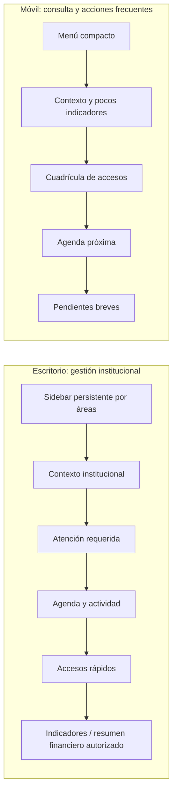

# Propuesta integral de experiencia de usuario para A&O ERP

**Tipo de documento:** análisis comparativo y propuesta; no autoriza cambios de interfaz, navegación o rutas.  
**Ámbito:** exclusivamente `apps/erp`.

## 1. Fuentes revisadas y alcance de la comparación

Se revisaron la definición funcional y arquitectónica de ERP, el estándar aprobado de formularios, el inventario y registro de implementación de formularios, y la implementación actual de Dashboard, navegación, layout y pantallas.

La revisión cubrió principalmente:

- `apps/erp/src/routes/index.tsx`: Dashboard y sus indicadores, agenda, finanzas y tareas.
- `apps/erp/src/data/navigation.ts`: clasificación actual de módulos y áreas.
- `apps/erp/src/components/layout/app-shell.tsx`: navegación persistente, expansión, usuario, topbar y adaptación móvil.
- `apps/erp/src/hooks/use-mobile.tsx`: breakpoint de detección móvil, 768 px.
- `apps/erp/src/components/modules/module-layout.tsx`: estructura reutilizada por módulos.
- `apps/erp/src/styles.css`: tokens de tema, tipografía y áreas de navegación.
- `apps/erp/src/components/forms/`: modal, página ampliada, panel lateral y componentes de sección y campo.
- `apps/erp/src/components/modules/liturgy-screen.tsx` y `mass-intentions-visual-pilot.tsx`: integración visible de las modalidades en el piloto.
- `docs/erp/definicion-funcional-y-arquitectonica.md` y `docs/erp/estandar-formularios.md`, además del inventario y el registro de implementación de formularios.

**Disponibilidad de la propuesta anterior:** no se encontró en el árbol documental del proyecto un archivo independiente con la propuesta de experiencia de usuario descrita en esta directriz. La comparación con esa propuesta se basa, por tanto, en el resumen que acompaña esta instrucción. Si existe un documento original con detalle adicional, conviene adjuntarlo antes de aprobar la implementación para cotejar decisiones y conservar su trazabilidad.

## 2. Estado actual de la experiencia de escritorio

### Shell y navegación

- El AppShell ofrece un sidebar persistente, azul institucional o blanco según el tema, que puede expandirse a 320 px o contraerse a 80 px. La navegación se mantiene en desktop; los grupos abiertos y la preferencia visual se almacenan localmente.
- Dashboard es un acceso directo en la parte superior, sin submenú «General».
- Los 27 módulos de ERP se distribuyen hoy en seis grupos: Gobierno e institución; Comunidad y pastoral; Finanzas y recursos; Gestión y control; Servicios; Sistema. El primer acceso Dashboard hace que la interfaz muestre siete bloques si también se cuenta su posición independiente, pero solo seis grupos expandibles.
- La ruta activa destaca el módulo y abre su grupo. La estructura se alimenta desde `navigation.ts`, lo que permite reorganizar etiquetas y pertenencia sin cambiar las rutas.
- La topbar contiene el botón de expansión y búsqueda. El perfil local demostrativo permanece anclado abajo.

### Dashboard

El Dashboard presenta una superficie clara con ancho máximo de 1.400 px. Su contenido actual incluye:

1. Encabezado de Dashboard y mensaje institucional.
2. Identificación de la parroquia y jurisdicción, con indicador de demostración.
3. Cuatro indicadores: feligreses, familias, referencias documentales y solicitudes pendientes.
4. Próximas actividades.
5. Resumen financiero ilustrativo por entidad contable.
6. Tareas pendientes con casillas locales.

La distribución se apila en una columna salvo la cuadrícula de indicadores, que presenta dos columnas y luego cuatro en desktop; el resumen económico usa hasta tres columnas desde `md`. No hay una sección específica de accesos rápidos a módulos. Los enlaces aparentes «Ver todas» y «Ver detalle» del encabezado son botones visuales sin navegación implementada en esta pantalla. Las casillas de tareas tampoco persisten.

### Módulos

`ModuleLayout` aporta breadcrumbs, título, descripción, acciones, indicadores y superficie central de hasta 1.360 o 1.440 px. Las pantallas internas reutilizan tablas, filtros, pestañas, paneles de detalle y tarjetas. Su composición varía según el propósito del módulo; la adaptación responde a breakpoints CSS, no a una experiencia funcional separada para escritorio.

## 3. Estado actual de la experiencia móvil

- `useIsMobile` considera móvil un viewport inferior a 768 px.
- El sidebar se convierte en panel fijo fuera de pantalla, se abre con el botón del encabezado y muestra un fondo de cierre. La página queda en una sola columna y la navegación sigue siendo la lista de módulos agrupados.
- No hay un dashboard móvil independiente, una cuadrícula de accesos directos ni una navegación inferior específica. El usuario recorre esencialmente el Dashboard y los módulos actuales en su composición adaptable.
- En el Dashboard, las tarjetas de indicadores son dos por fila; agenda, resumen financiero y tareas se apilan. El encabezado conserva padding de 16 px en móvil y las secciones mantienen superficies de tarjeta. Es usable como página responsiva, pero su secuencia larga no es el resumen compacto descrito en la propuesta.
- Los módulos conservan sus datos y controles. El comportamiento móvil depende de clases responsive particulares; tablas densas, pestañas y formularios deben validarse pantalla por pantalla para detectar desplazamiento horizontal y jerarquías largas.
- La barra superior permanece visible durante el scroll. No se encontró un patrón global de navegación táctil alternativo a abrir el sidebar.

## 4. Comparación con la propuesta anterior resumida

| Aspecto                  | Implementación actual                                                                       | Propuesta resumida                                                                                    | Diferencia y consecuencia                                                                                                                                                           |
| ------------------------ | ------------------------------------------------------------------------------------------- | ----------------------------------------------------------------------------------------------------- | ----------------------------------------------------------------------------------------------------------------------------------------------------------------------------------- |
| Dashboard de escritorio  | Resumen de comunidad, cifras documentales, agenda, finanzas y tareas en secuencia vertical. | Indicadores, accesos rápidos y herramientas de gestión claramente organizados.                        | Faltan accesos rápidos funcionales y priorización visible por atención requerida; la pantalla combina indicadores de áreas distintas sin orden por tarea.                           |
| Navegación de escritorio | Sidebar expandible, con seis grupos y Dashboard independiente.                              | Ocho áreas: Dashboard; Institución; Comunidad; Pastoral; Administración; Gestión; Servicios; Sistema. | La agrupación «Comunidad y pastoral» mezcla dos áreas y «Finanzas y recursos» usa una denominación diferente de Administración.                                                     |
| Espacio de trabajo       | Shell y contenedores fluidos con límites máximos; layout de módulo hasta 1.360/1.440 px.    | Aprovechar espacio amplio para tablas, paneles y herramientas.                                        | La base ya permite ancho amplio. Falta validar individualmente tablas/paneles y ordenar Dashboard; no se justifica ampliar todo a un ancho fijo común.                              |
| Dashboard móvil          | Mismo contenido, apilado y con dos indicadores por fila.                                    | Dashboard compacto, accesos en cuadrícula y agenda próxima.                                           | No existe variante compacta ni acceso directo visible a módulos; el usuario desplaza una secuencia larga para consultar agenda, finanzas y tareas.                                  |
| Navegación móvil         | Sidebar deslizable y lista completa de grupos y módulos.                                    | Navegación sencilla adaptada al tacto.                                                                | La navegación funciona, pero reproduce la taxonomía y densidad desktop; se puede evaluar una capa de accesos frecuentes conservando acceso a todos los módulos.                     |
| Formularios              | Modal, página ampliada y panel lateral compartidos; piloto visible en Liturgia.             | Formularios integrados con naturalidad en la experiencia global.                                      | La infraestructura está disponible y demostrada en el piloto. Otros formularios no están migrados y no se deben considerar parte de este trabajo hasta una autorización por módulo. |

La estructura objetivo aprobada en la definición funcional vigente tiene 27 módulos más Dashboard y agrupa Comunidad y pastoral en una sola categoría. La separación posterior entre Comunidad y Pastoral y el nuevo nombre Administración son una **propuesta de presentación**, no una modificación de alcance funcional; requieren validación antes de cambiar el menú.

## 5. Propuesta de Dashboard para escritorio

Mantener una sola ruta `/` y los mismos datos institucionales, con jerarquía orientada a trabajo diario:

1. **Contexto institucional:** nombre de la parroquia, periodo y etiqueta demostrativa; distinguir claramente jurisdicción canónica de acceso a información.
2. **Resumen prioritario:** un conjunto breve de indicadores seleccionables por utilidad parroquial. No mostrar datos personales o sacramentales nominativos en tarjetas agregadas sin una autorización de acceso definida.
3. **Atención requerida:** pendientes próximos y alertas con su módulo de origen y enlace funcional; no convertir la demostración en tareas productivas ni simular estados reales.
4. **Agenda próxima:** pocos eventos con fecha, hora y sede, con acceso al módulo Agenda o Liturgia cuando corresponda.
5. **Accesos rápidos:** mosaico pequeño de tareas o módulos frecuentes, claramente navegable y configurable en una fase posterior.
6. **Resumen financiero opcional:** agregarlo solo como información de la entidad contable parroquial correspondiente y bajo acceso autorizado; no mezclar entidades ni proyectar supervisión diocesana.
7. **Actividad reciente:** dejarla condicionada a una fuente de trazabilidad real y a permisos; mientras los datos sean demostrativos, rotularlos como tales.

No convertir el Dashboard en una colección de tarjetas sin jerarquía. La prioridad propuesta es acción requerida, agenda y accesos frecuentes; los indicadores actúan como resumen y no sustituyen los módulos de gestión.

## 6. Propuesta de Dashboard para móvil

La vista móvil debe ser una composición resumida del mismo Dashboard, no un producto con datos o reglas diferentes:

- Encabezado compacto con parroquia y periodo, más una acción de búsqueda o navegación accesible.
- Dos o tres indicadores principales, con cifras agregadas y etiquetas breves.
- Cuadrícula táctil de accesos directos, por ejemplo dos columnas, limitada a acciones elegidas para la jornada y enlaces a los módulos existentes.
- Tarjeta de agenda inmediata con próximas actividades y enlace al calendario completo.
- Lista breve de pendientes con origen y prioridad de atención.
- Resumen financiero solo si el perfil y el ámbito contable permiten mostrarlo; evitar cifras pequeñas de baja legibilidad.
- Acceso persistente al menú completo para conservar cobertura de las 27 pantallas.

El modo móvil debe reducir contenido y facilitar consulta; no debe crear operaciones nuevas ni duplicar formularios. Las zonas táctiles, foco, orden de lectura, estados de carga/vacío y desbordamiento requieren pruebas específicas en anchos pequeños.

### Esquema comparativo de composición

## 7. Organización de navegación en ocho áreas

Esta es una distribución candidata de presentación. Mantiene los 27 módulos y Dashboard, preserva cada ruta y separa las áreas actualmente fusionadas:

| Área propuesta    | Módulos que agruparía                                                                                                                  |
| ----------------- | -------------------------------------------------------------------------------------------------------------------------------------- |
| 1. Dashboard      | Dashboard (`/`) como acceso directo, sin submenú.                                                                                      |
| 2. Institución    | Institución; Estructura eclesiástica; Administración institucional; Gobierno y normativa; Usuarios y permisos.                         |
| 3. Comunidad      | Feligreses y familias; Gestión sacramental; Libros sacramentales; Documentos y certificados.                                           |
| 4. Pastoral       | Catequesis y formación; Grupos, movimientos y ministerios; Acción pastoral y social; Liturgia y celebraciones; Planificación pastoral. |
| 5. Administración | Finanzas y tesorería; Contabilidad; Presupuestos; Inventarios y patrimonio; Compras y obligaciones.                                    |
| 6. Gestión        | Informe anual parroquial; Agenda e infraestructura; Gestión documental; Auditoría y trazabilidad.                                      |
| 7. Servicios      | Portal del feligrés; Comunicaciones; Inteligencia artificial.                                                                          |
| 8. Sistema        | Configuración.                                                                                                                         |

No se incluye Gestión diocesana y supervisión en estas áreas: la definición arquitectónica vigente reserva la autoridad y gestión territorial para A&O Diocesano. Si la ruta antigua sigue disponible temporalmente, no debe reintroducirse en la navegación parroquial por efecto de esta reorganización. Administración de plataforma tampoco pertenece a ERP.

Antes de aplicar la clasificación, aprobar explícitamente si «Institución» contiene estructura y usuarios, y si los documentos/certificados se agrupan en Comunidad. Las rutas y nombres de módulos no necesitan cambiar para alterar su grupo.

## 8. Integración con el estándar de formularios

El estándar se mantiene transversal a desktop y móvil, y debe invocarse desde la tarea que lo necesita:

- **Modal estándar:** captura o edición puntual, breve y con contexto suficiente, con foco accesible y scroll interno.
- **Formulario ampliado:** proceso con varias secciones o contenido que requiere espacio; en móvil se convierte en una columna dentro de la pantalla.
- **Panel lateral:** consulta de detalle y tarea complementaria sin abandonar el módulo; en móvil puede ocupar el ancho disponible y debe preservar cierre/foco accesibles.

Los tres modos conservan secciones, campos, etiquetas, ayudas, estados y vocabulario. En escritorio se priorizan dos columnas solo cuando hay ancho; en móvil se apila. El piloto de Intenciones de Misa valida únicamente la composición visual y entradas temporales ficticias. No implementa la Fase 2A ni habilita la migración de los formularios inventariados en otras pantallas.

La experiencia global no debe abrir formularios por defecto desde accesos rápidos sin explicar el contexto. Las acciones de Dashboard navegan a módulos; cualquier nueva captura sigue pendiente de autorización funcional independiente.

## 9. Componentes que pueden reutilizarse

- `AppShell` y los tokens de `styles.css`: shell, temas, perfil y comportamiento responsive existentes.
- `navigation.ts`: catálogo central de módulos, rutas e iconos; puede añadirse una taxonomía explícita de áreas, una vez aprobada, sin modificar rutas.
- `ModuleLayout`, `PageHeader`, `StatCard`, `DemoNotice`, `DataTable`, Tabs y DetailDrawer para mantener consistencia de páginas existentes.
- Componentes de gráficos, agenda y acciones rápidas presentes en los módulos, después de verificar sus props, accesibilidad y condición demostrativa.
- `FormModal`, `FormPage`, `FormDrawer`, `FormHeader`, `FormSection`, `FormField` y `FormActions` para los nuevos formularios autorizados.
- Datos de `parish-demo`, `institutional-demo`, `economy-demo`, `community-demo` y `pastoral-demo`, con revisión de límites de exposición y rotulación demo.

No compartir menús, dashboards, roles o información entre ERP, SaaS y Diocesano. La propuesta solo organiza la UX de ERP; su separación es un principio de arquitectura aprobado.

## 10. Componentes que requerirían modificación

1. **`navigation.ts`:** modelar «área» como dato de navegación independiente del nombre del grupo actual, definir orden e icono y mantener path/id actual. Esto evita inferir agrupación desde etiquetas.
2. **`app-shell.tsx`:** presentar las ocho áreas en escritorio y móvil; resolver expansión, área activa, tooltips, teclado, foco del menú móvil y acceso a todas las pantallas. Determinar si móvil usa el mismo drawer o una navegación adicional solo después de validar el prototipo.
3. **`index.tsx`:** separar los bloques desktop/móvil con composición responsive reutilizable, enlaces funcionales a módulos y datos agregados apropiados. Evitar copiar y mantener dos fuentes de datos.
4. **`ModuleLayout` y módulos:** revisión de overflow, tablas, filtros, calendarios, acciones y paneles; modificar solo las pantallas que fallen en el inventario de resoluciones.
5. **Componentes de accesos y agenda:** crear solo si los componentes existentes no cubren tarjetas de acceso, listas compactas o estado vacío; conservar las rutas como fuente de navegación.
6. **Formularios:** no modificar la infraestructura actual por defecto. Ajustar shared fields/modal/drawer solo si la validación de experiencia integral encuentra una barrera reproducible y dentro de autorización.

## 11. Riesgos, dependencias y fases sugeridas

| Fase sugerida                       | Trabajo                                                                                                                                        | Dependencias / aceptación                                                               |
| ----------------------------------- | ---------------------------------------------------------------------------------------------------------------------------------------------- | --------------------------------------------------------------------------------------- |
| 0. Confirmación de la propuesta     | Adjuntar la especificación UX anterior si existe; aprobar taxonomía de ocho áreas, orden, módulo por área y contenido visible por perfil.      | Aprobación humana; no modifica aplicación.                                              |
| 1. Inventario visual y métricas     | Medir Dashboard, sidebar, tablas y formularios en 1440, 1024, 768, 390 y 360 px; catalogar overflow, acciones sin navegación y datos visibles. | Requiere servidor de ERP y criterios visuales; produce baseline y pruebas de regresión. |
| 2. Taxonomía y prototipo navegable  | Separar el concepto de área del grupo actual y validar sidebar expandible, modo contraído y navegación móvil con URLs existentes.              | Mantener 27 módulos, Dashboard y rutas; comprobar acceso directo y módulo activo.       |
| 3. Dashboard desktop                | Ordenar contexto, atención requerida, agenda, accesos, indicadores y resumen financiero bajo reglas de privacidad.                             | Fuente local demo coherente; enlaces funcionales; sin tareas persistentes.              |
| 4. Dashboard mobile                 | Componer resumen compacto, cuadrícula de accesos y agenda en el mismo root, con navegación completa accesible.                                 | Fase 3; mismo modelo de datos, responsive tests táctiles y de lector/teclado.           |
| 5. Adaptación progresiva de módulos | Corregir únicamente desbordamientos y tareas concretas por pantalla; priorizar tablas y agenda.                                                | Inventario de fase 1; autorización por lotes; no migración masiva.                      |
| 6. Formularios y cierre visual      | Confirmar modal, ampliado y lateral dentro del flujo global, revisar foco/teclado/tacto y adjuntar evidencias por dispositivo.                 | Estándar aprobado; cada migración de formulario precisa autorización específica.        |

### Riesgos y controles

- **Clasificación ambigua:** dividir Comunidad y Pastoral o cambiar «Finanzas y recursos» por Administración puede afectar expectativas de navegación. Obtener aprobación del mapa de áreas antes de cambiar la navegación.
- **Pérdida de acceso por cambio de grupo:** conservar path e id, navegación directa por URL, aria-current y expansión del área activa; cubrir en pruebas de rutas.
- **Duplicidad desktop/móvil:** dos dashboards independientes divergirían en cifras. Compartir datos/modelo y adaptar solo la composición.
- **Exposición de datos:** sacramentos y finanzas son sensibles. Mostrar solo agregados pertinentes; permisos efectivos y autorización por usuario no están implementados y no pueden asumirse.
- **Indicadores sin semántica productiva:** datos y tareas actuales son demostrativos; rotularlos y evitar lenguaje de confirmación o estado real.
- **Sobreajuste de ancho:** conservar contenedores fluidos con límites específicos; no imponer un ancho único a formularios, tablas y Dashboard.
- **Experiencia móvil que oculta módulos:** la cuadrícula rápida debe complementar el acceso completo, no reemplazarlo.
- **Dependencia SaaS/Diocesano:** no incluir herramientas de plataforma o supervisión territorial dentro de las áreas ERP.
- **Cambios amplios al AppShell:** afectan todas las rutas; prototipar taxonomía, teclado, tamaños táctiles y temas antes de migrar cualquier pantalla.

## 12. Decisiones que requieren aprobación antes de implementar

1. Si la organización de ocho áreas sustituye la agrupación funcional vigente y los nombres propuestos quedan aprobados.
2. El mapa final de módulos por área, en particular la separación Comunidad/Pastoral y el uso de «Administración».
3. Si el Dashboard móvil será una variante responsive de la misma ruta o si se requiere una composición alternativa, sin crear rutas nuevas.
4. Qué indicadores se consideran prioritarios y cuáles pueden verse según responsabilidades; no se infieren roles ni permisos reales.
5. Si se incluyen tarjetas financieras agregadas y con qué alcance de entidad contable.
6. Qué accesos rápidos son prioritarios y si se configuran localmente o quedan fijos en esta etapa visual.
7. El documento original de la propuesta anterior, si existe fuera del repositorio, para cerrar la comparación documental.

## Dictamen

La base de ERP ya tiene sidebar contraíble, grupos persistentes, shell móvil, tokens compartidos, un Dashboard con indicadores y agenda y un estándar de tres modalidades de formulario probado visualmente en el piloto. La propuesta integral continúa pendiente: no existe aún Dashboard móvil compacto, cuadrícula de accesos ni navegación separada por las ocho áreas, y la organización propuesta difiere de la clasificación funcional actualmente documentada.

Se recomienda autorizar primero el prototipo de navegación por ocho áreas y la validación comparativa de Dashboard desktop/móvil, tras aprobar el mapa de módulos. Esta revisión no cambia componentes, rutas, módulos ni datos. No se modificaron las aplicaciones SaaS o Diocesano.
